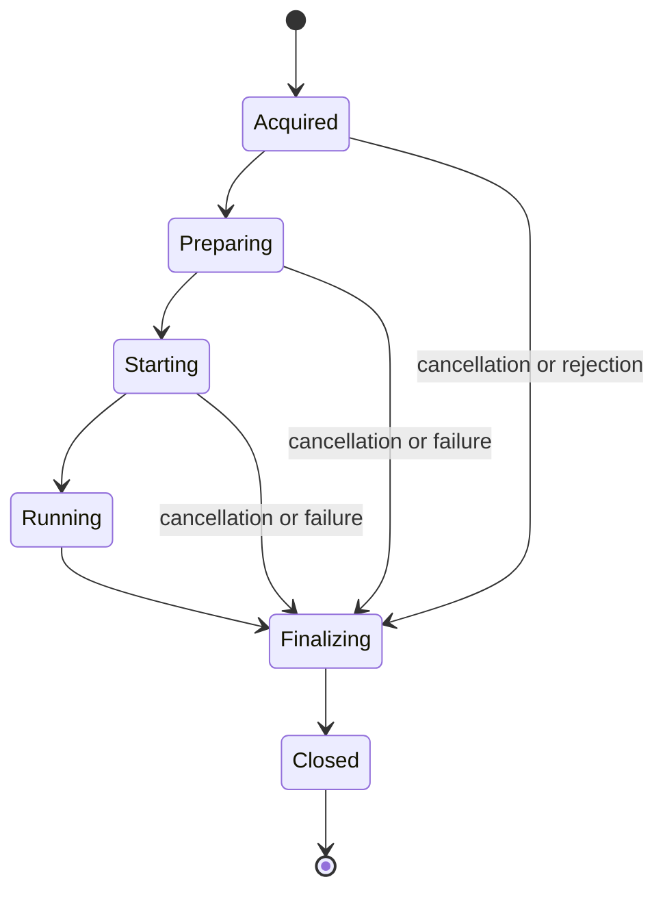

# Agent2 implementation plan

## 1. Purpose

Create `agent2` as the replacement for the current `agent` module.
Support Concord runtime v2 only.
Keep the required external interfaces, but replace the internal execution model.

Use the [agent specification](../specs/agent.md) as the compatibility baseline.
This document states planned behavior, not implementation status.
This document uses ASD-STE100 writing rules and software technical terms.

Use these requirements for the implementation:

- Replace v2 agent deployments without server protocol changes.
- Give each assignment, slot, child process, and file one owner.
- Make cancellation available during each execution stage.
- Set limits on network waits, resource use, and shutdown.
- Transfer output reliably. Report clearly when delivery is uncertain.
- Use a small internal design. Do not add runtime selection frameworks or compatibility adapters.
- Add `it/agent2` for integration tests with `testcontainers-concord`. Include basic smoke flows.

### Technical terms

| Term | Meaning |
| --- | --- |
| assignment | One process response accepted by the agent. A subsequent resume is a separate assignment. |
| slot | Capacity reserved for one pending request or active assignment. |
| runner | The existing Concord v2 Java process that executes workflows. |
| owner | The component responsible for a resource and its release. |
| drain | Stop new assignments while existing assignments complete. |
| spool | Private local storage for output whose transfer is not completed. |
| finalization | Output transfer, final-status delivery, and resource release after execution. |
| prefork | A spare runner process that waits for a payload. |

## 2. Compatibility boundary

### 2.1 Meaning of drop-in replacement

Keep the interfaces used by supported v2 workloads and the usual deployment tools.
Do not keep runtime-v1 behavior, unused settings, unsafe cleanup rules, or undocumented bugs.

| Area | Required compatibility |
| --- | --- |
| Server connection | Existing WebSocket messages, headers, correlation IDs, capability rules, and reconnect behavior. |
| Process APIs | Existing authentication, snapshots, logs, attachments, and status endpoints. |
| Runner | Existing v2 JAR, configuration schema, startup files, environment, and exit behavior. |
| Workflows | Existing v2 repositories, imports, dependencies, plugins, suspension, resume, and output variables. |
| Operation | Existing service mode, one-shot input, maintenance URL, and maintenance response fields. |
| Deployment | Existing image entrypoint, supported environment variables, ports, mounts, and `concord-agent` configuration root. |

An API path that contains `/api/v1` does not imply runtime-v1 support.
When these endpoints are necessary for the v2 execution contract, keep them.
An older client library can be necessary for a v2 plugin.
Do not remove a plugin dependency only because its name contains `v1`.

This plan does not include a workflow-language change, a new server endpoint, or a new queue protocol.
The existing v2 runner stays responsible for workflow execution, heartbeats, checkpoints, and saved state.
The server stays responsible for dispatch, watchdogs, and failure-handler processes.

### 2.2 Unsupported runtimes are hard errors

After the snapshot overlay, do a check of `_main.json.runtime`.
Accept only `concord-v2`.
Treat v1, unknown runtime names, and a missing runtime as hard preparation errors.
The current agent interprets a missing runtime as v1.

Report `FAILED` with a clear unsupported-runtime diagnostic.
Do not start a runner, change the runtime, or requeue the assignment.
Complete usual finalization. Then, release the slot.
Keep the agent available for subsequent supported assignments.

The current server matches agent capabilities, not the process runtime.
An empty requirement object matches every agent.
Thus, an unsupported assignment can get to agent2 and fail.
This is permitted for the initial implementation.
Runtime-aware routing is not necessary before rollout.

Source: [server dispatch selection][dispatcher].

### 2.3 Keep, replace, and remove

| Decision | Scope |
| --- | --- |
| Keep | Git and Maven input, secret access, GitHub App authentication, dependency policy, caches, and archive limits. |
| Keep | Enabled directory imports, JVM argument precedence, Docker tasks, volume settings, and log masking. |
| Keep | Optional prefork, one-shot execution, process-log redirection, and private diagnostic copies. |
| Replace | Queue lifecycle, assignment control, runner cleanup, log transfer, finalization, and shutdown. |
| Remove | V1 runner loading, v1 fallback, generic runtime maps, executor factories, and runtime-specific branch chains. |
| Remove | The outer agent's Guice/Sisu discovery layer, per-worker injectors, and one-implementation service interfaces. |
| Remove | Legacy unsegmented runner-output handling. Use the v2 system segment for preparation messages. |
| Remove | Unused server-token provider, inactive SecurityManager controls, dead settings, and obsolete aliases. |
| Remove | `ollie.conf`, `server.websockerUrl`, old OAuth shortcuts, and implicit injection of v1-client dependencies. |

Keep necessary wire fields even when their names are historical.
Do not remove `processInfo.sessionKey` data from server snapshots. The existing runner accepts it.
Keep the JVM argument precedence from `_agent.json` because it changes active process behavior.

## 3. Module and dependency design

Add Maven module `agent2` with artifact `com.walmartlabs.concord:concord-agent2`.
Use package `com.walmartlabs.concord.agent2` and the repository's Java 25 baseline.
Do not depend on the old `concord-agent` artifact.

Construct the outer agent explicitly in `Main`.
Use immutable configuration values and ordinary constructor parameters.
Unless an interface is necessary for an existing shared API, use concrete classes.
Do not add a service locator, event bus, plugin framework, or generic execution pipeline.

Reuse repository, import, dependency, policy, secret, and runtime-common code when its behavior meets the contract.
Do not copy artifact resolution, secret formats, or runner log formats into a second library.
When a shared correction is necessary for the two implementations, repair the defect at its owner.
Keep unrelated server, console, and runtime changes outside this work.

Use the queue message classes. Do not use the old `QueueClient` transport.
Exclude that dependency's unused Jetty transport dependencies from the agent2 distribution.
Use the JDK WebSocket client for the new connection lifecycle.
Use `client2` for existing HTTP APIs, with one explicit request policy.
Do not build a second general-purpose framework for HTTP clients.

Disable automatic v1-client insertion in the dependency manager.
Continue to resolve libraries that are necessary for v2 plugins.
Bundle only the v2 runner in the agent2 distribution.

Sources: [current agent dependencies][agent-pom], [queue dependencies][queue-pom], [dependency manager configuration][dependency-config].

## 4. Internal structure

Use a small set of concrete resource owners.
These names describe responsibilities. A package or interface for each row is not necessary.

| Owner | Responsibility |
| --- | --- |
| `Agent` | Service lifecycle, capacity, active assignments, maintenance, and shutdown. |
| `QueueConnection` | One socket, request correlation, connection generation, heartbeat, and reconnect. |
| `ProcessRun` | One assignment, cancellation, execution outcome, finalization, and slot release. |
| `Workspace` | Input assembly, private paths, snapshot overlay, and file cleanup. |
| `RunnerProcess` | V2 launch, process-tree ownership, output pipes, and termination. |
| `RunnerPool` | Optional spare processes, strict capacity, expiry, and disposal. |
| `ProcessOutput` | Segmented decoding, bounded spool, ordered transfer, and attachment preparation. |

Use shared library services directly from these owners.
Do not add a factory and adapter around each service.
The maintenance handler reads agent state. It does not own a second worker registry.

Use one virtual-thread lifecycle task for each assignment.
Use a shared scheduler for deadlines and pool maintenance.
Do not create an executor service for each worker or each HTTP request.

Keep socket callbacks short.
They update connection state and deliver events to the assignment owner.
They must not fetch repositories, upload files, or wait for process termination.

Protect short state changes with explicit synchronization.
Do not hold lifecycle locks during network or filesystem operations.
Keep the cancellation signal separate from the thread that does blocking work.

### Resource invariants

1. Before you send a process request, reserve capacity.
2. Register an accepted assignment before preparation starts.
3. Give each assignment one completion owner.
4. Release each slot one time only.
5. Keep ownership until child processes and file writers stop.
6. Do not share process credentials or mutable workspace files between assignments.
7. Do not publish `_instanceId` before the payload is completed.
8. Do not report successful completion before the necessary attachment transfer succeeds.

## 5. Assignment and queue control

### 5.1 Assignment lifecycle

These are local states, not new server status values.
Keep the execution outcome separate from the output-delivery outcome.
The existing runner continues to send `RUNNING` and process heartbeats.

Keep cancellation available from acceptance until the completion decision.
Do a cancellation check before each stage and after each blocking operation.
Cancellation must also interrupt active network work and stop owned Git or runner processes.
Thread interruption alone is not sufficient for every shared library.

Serialize cancellation and completion decisions in `ProcessRun`.
Cancellation accepted before the decision produces `CANCELLED`.
A command received after the decision does not replace the recorded outcome.
A stage timeout produces `FAILED`, unless cancellation already owns the decision.

Finalize one time only, including preparation failures and startup failures.
Repeated commands must not cause repeated cleanup or repeated capacity release.
Do not run server-managed cancellation or failure handlers inside agent2.

### 5.2 Queue rules

Before you send a request, register its pending correlation ID.
Let the connection have one process request and one command request.
Associate pending requests with a connection generation.
Ignore callbacks from a closed generation. Do not change current capacity because of those callbacks.

Keep command acquisition active during execution, finalization, and drain.
Do not restart a runner when the socket reconnects.
Detect duplicate responses while an assignment is active.
A subsequent resume with the same process UUID stays a valid new assignment.

On drain, stop process demand.
If necessary, reconnect without a process request.
Before you report that the agent is idle, account for every response already received.
A response during this transition must not disappear from the local registry.
The server watchdog stays necessary for assignments lost before receipt.

Bound connection attempts, inactive periods, and retry delays.
Use separate deadlines for queue health and process API calls.
A WebSocket pong must not replace a process heartbeat.

## 6. Input and runner execution

### 6.1 Workspace preparation

Keep the input order: repository, imports, then server snapshot.
Keep unknown server files and the existing v2 state layout.
Only after the snapshot overlay, read the effective process configuration.

Create private workspace directories with explicit ownership and restrictive permissions.
Keep preparation and publication on the work filesystem.
Do not make an atomic move between separate filesystems necessary.
Use one publication step for the completed payload and startup marker.

Keep the documented `${workDir}` behavior for initial execution and resume.
Do not introduce random work paths for non-prefork execution.
Use unique staging paths that are private so concurrent or stale assignments cannot collide.

Enforce archive limits during extraction, not only from advertised ZIP sizes.
Reject escaping paths, unsafe import destinations, and writes through escaping symbolic links.
Unless the operator enables directory imports, keep them disabled.
Constrain enabled directory imports to approved source roots.

Before you start a runner, apply dependency policy.
Bound artifact network operations, redirect chains, repository locks, and dependency preparation.
Use existing caches with their ownership and lock rules.
Do not place process secrets in shared cache metadata.

### 6.2 Runner ownership

Use the existing v2 configuration, command, environment, and file interfaces.
Keep JVM argument precedence and the Docker settings that are necessary for existing tasks.
Use segmented output only.
Do not add a replacement workflow engine or an agent-to-runner RPC protocol.

Treat process creation and ownership registration as one controlled operation.
If cancellation wins during startup, terminate the new process before you return from that stage.
Continue to drain stdout and stderr while you wait for process exit.

Terminate all processes in the owned process tree, including direct children.
Use a bounded graceful wait. Then, use forced termination. Then, use a last bounded wait.
Track process identity so a reused operating-system PID cannot identify an unrelated process.
Use the deployment's process group or container boundary for final cleanup after an agent crash.

If an owned process survives the deadline, stop acceptance of new work.
Then, report an operational failure.
Do not release its workspace for reuse while it can continue to write files.
The service supervisor must remove the remaining process group that the agent owns.

### 6.3 Prefork and Docker cleanup

Keep prefork optional and disabled by default.
Use the current eligibility rules for process libraries and custom JVM arguments.
Count spares that start and idle spares against a strict limit.
Before you take a spare, do a check of its liveness, age, and configuration.
Dispose of expired, canceled, or unused spares during drain and shutdown.
A consumed spare executes one assignment and does not return to the pool.

Keep Docker task support. Do not copy the global orphan-sweeper design.
Remove only containers whose ownership is established for this agent.
The current `concordTxId` label alone does not prove agent ownership.
Legacy-label cleanup is permitted only when the deployment guarantees an exclusive Docker daemon.
Do not scan a shared daemon and delete containers merely because their process IDs are absent locally.

## 7. Output delivery and failure handling

### 7.1 Logs and attachments

Decode the segmented stream from v2 incrementally.
Bound header size, numeric fields, and parser memory.
Handle split headers, split UTF-8 data, timestamps, and final partial input explicitly.
Route nonprotocol output to the system segment. Do not corrupt valid records.
A malformed record must not trigger an uncontrolled exception in the stream reader.

Spool pending output in private, bounded local files.
Transfer each segment in order. Keep data until the request result is known.
Do not add an unbounded in-memory queue or a general message broker.
Do not discard exhausted retries without a visible delivery error.

On a spool limit or disk failure, stop acquisition of more assignments.
If collection cannot continue, stop the affected runner.
Record the failure independently from earlier workflow outcomes.
Apply bounded retention to diagnostic copies and incomplete output.
Do not make credentials or work files that the agent keeps readable by all local users.

After runner exit, complete log collection. Then, upload the attachment ZIP.
Keep the ZIP root and suspension-marker rules from the specification.
When safe files are available after execution failure, try to collect output.
Only after the necessary output steps give their specified result, send the final status.

### 7.2 Request policy and protocol limits

Use operation-specific deadlines and a bounded retry policy.
Retry transient transport failures and temporary HTTP failures that the request policy supports.
When the server supplies retry delays, use those delays.
Do not retry authorization errors or permanent input errors as transient failures.

The current server does not provide log-append deduplication.
An uncertain response followed by retry can duplicate log bytes.
Do not claim exactly-once log delivery.

The server also lacks assignment acknowledgment, command acknowledgment, and an attempt token for final-status updates.
Read server state after uncertain final-status delivery.
When the agent finds a conflicting terminal state, suspension, or reassignment, stop the retries.
A read followed by a write is not atomic. It cannot remove every race.

Do not replay old attachment or status requests automatically after agent restart.
A resumed process can have the same UUID and session credential as an older assignment.
Do not build durable execution recovery without a server-side attempt identifier.

If finalization reaches its deadline, keep bounded evidence and report incomplete delivery.
When the agent cannot safely complete output transfer, enter drain.
Only after all owned activity stops, release execution capacity.
Do not report an unresolved remote result as confirmed success.

## 8. Configuration and operation

Keep `concord-agent`, `-Dconcord.conf`, and the supported deployment environment variables.
Keep supported `runner` defaults and `runnerV2` overrides, without a generic `runtimes` registry.
Keep service mode and the current contract for one-shot JSON input.
Use the same execution path in the two modes.
One-shot mode must return a failure exit code when necessary finalization fails.

Load configuration one time only.
Resolve precedence one time only.
Before you connect to the queue, validate the configuration.
Report unsupported or removed settings with their replacement or removal reason.
Do not silently accept settings that have no effect.

Publish an explicit configuration migration table before deployment.
It must cover these deliberate changes:

| Change | Required action |
| --- | --- |
| Removed v1 settings, generic runtime entries, and aliases | Remove them from deployed configuration. Do not add compatibility aliases. |
| TLS verification | Enable verification by default for HTTP and WSS. Support an explicit insecure setting with a warning. |
| Relative directory prefixes | Replace random-prefix behavior with documented path resolution. Use absolute paths for persistent work and caches. |
| Dead retry settings | Replace them with settings that control the new request policy. |
| Process-tree cleanup | Make cleanup mandatory. Remove the ineffective optional control. |
| Docker orphan cleanup | Proven ownership or an exclusive daemon is necessary. Reject unsafe shared-daemon configuration. |
| Diagnostic retention | Use private permissions, storage limits, and a retention deadline. |

Keep `GET` and `POST /maintenance-mode`, port configuration, and JSON response fields in compact form.
The operator's shell hook expects `maintenanceMode` and `workersAlive` without added formatting spaces.
Count active preparation, execution, finalization, and unresolved reservations in the busy result.
Do not report zero while owned work stays active.

On `SIGTERM`, do these steps:

1. Enter drain.
2. Stop spare creation.
3. Keep cancellation available.
4. Wait for active assignments within the configured shutdown deadline.
5. Cancel remaining work.
6. Flush available output.
7. Close all sockets, listeners, timers, and executors.

Align this deadline with the deployment's termination grace period.
If the agent cannot safely stop its owned resources, return a nonzero service result.

Sources: [operator client][operator-client], [operator shutdown hook][operator-hook], [current startup script][start-script].

## 9. Implementation sequence

Each phase must produce working behavior and its acceptance evidence.
Do not switch production packaging before all release gates pass.

| Phase | Work | Exit condition |
| --- | --- | --- |
| 1. Contracts and modules | Add `agent2`, configuration, and explicit construction. Register `it/agent2` and its `testcontainers-concord` harness. | The agent starts and closes cleanly. The integration harness starts the actual agent2 build. |
| 2. Acquisition and control | Implement queue correlation, slot ownership, cancellation, maintenance, and connection generations. | Real server assignments obey capacity. Reconnect and drain do not lose received work. |
| 3. V2 execution | Implement workspace assembly, dependency policy, runner launch, state files, and process-tree cleanup. Add execution smoke flows. | V2 success, workflow failure, and unsupported-runtime checks pass in `it/agent2`. |
| 4. Output and completion | Implement segmented logs, spool limits, attachments, final-status handling, and bounded finalization. Add output and resume smoke checks. | Logs, output variables, suspension, and resume pass in `it/agent2` with the unchanged server. |
| 5. Remaining supported features | Complete secrets, imports, Docker tasks, prefork, one-shot mode, and private diagnostics. | Every feature that the implementation keeps has an exercised compatibility scenario. |
| 6. Failure and shutdown checks | Exercise network loss, disk limits, races, malformed output, child cleanup, and forced shutdown. Complete cancellation and drain smoke checks. | The full `it/agent2` smoke suite and targeted failure tests pass. |
| 7. Packaging and rollout | Update image assembly, launchers, v2 test consumers, and deployment settings. | A drained pool can switch to agent2 and pass operator and workflow checks. |
| 8. Default cutover | Select agent2 for supported v2 deployments. Remove obsolete v2 integration paths. | No production v2 path depends on the old agent or its injection model. |

Phases 3 through 5 complete the implementation before the release gate.
They are not separate releases with reduced scope.

## 10. Verification and release gates

### 10.1 Necessary integration module

Create `it/agent2` as a separate integration-test module for Maven.
Register it in [the integration parent][it-parent].
Use JUnit 5 and the existing `testcontainers-concord` dependencies:

- `ca.ibodrov.concord:testcontainers-concord-core`.
- `ca.ibodrov.concord:testcontainers-concord-junit5`.

Use the repository-managed dependency versions and the existing `it` profile with Maven Failsafe.
Keep tests in `src/test/java` and smoke flows in `src/test/resources`.
Use the naming and configuration conventions from [the runtime-v2 module][runtime-v2-pom].

The harness must start a real database, Concord server, and agent2 with the v2 runner.
It must select the agent2 build under test, not an image for the old agent that was published earlier.
Do not use the in-process helper from the old agent or mock the server and runner.
The new module must run independently from `it/runtime-v2` and `it/server`.

1. Submit flows through the public process API.
2. Assert server-visible status, log content, output values, and attachment content as applicable.
3. Use bounded waits for state changes, not fixed sleep intervals.
4. Isolate process data, ports, and temporary files between tests.
5. Use flows that operate without public services or user credentials.
6. Release containers and temporary resources after success or failure.
7. When a test fails, keep server, agent, and process logs.

### 10.2 Basic smoke flows

Implement this minimum suite before cutover:

| Scenario | Required observation |
| --- | --- |
| V2 success | A simple flow reaches `FINISHED`. Expected segment text, an output value, and attachment bytes are available through the API. |
| Workflow failure | A deliberate workflow error reaches `FAILED` with its diagnostic. A subsequent v2 flow completes on the same agent. |
| Unsupported runtime | V1 and unknown runtime names produce a hard error without fallback. An assignment rejected by agent2 starts no runner and releases its slot. |
| Cancellation | Cancel a running flow through the API. It reaches `CANCELLED`, stops owned work, and lets a subsequent v2 flow run. |
| Suspension and resume | A flow reaches `SUSPENDED`, resumes through the API, and reaches `FINISHED` with the same saved value. |
| Maintenance drain | With one agent, enable maintenance during a running flow. Existing work completes. New work stays queued, and the busy count reaches zero. |

If the server rejects an unknown name before dispatch, do an API error check in the smoke suite.
Also do a test of agent2's unsupported-runtime check directly at the assignment boundary.
Do not count a server-side rejection as proof that agent2 released a slot.

Document image-build prerequisites and the exact module command in `it/agent2/README.md`.
Make the smoke suite a required CI check for agent2 changes and release candidates.
After you build the necessary images, use `./mvnw -pl it/agent2 -am verify -Pit` as the module command.
CI must fail on test failures, skipped necessary scenarios, or failure to start the harness.

### 10.3 Broader release gates

The basic smoke suite does not replace these broader checks.
Use existing runtime-v2 and operator scenarios where possible.
Add regression tests for observable failures, not constructor wiring or copied configuration values.

| Gate | Required evidence |
| --- | --- |
| Runtime acceptance | Unsupported assignments fail clearly. They do not start a runner. No routing change is necessary to accept this behavior. |
| Protocol | Valid authentication, correlation, capability selection, ping, reconnect, and command delivery work against the current server. |
| Inputs | Repository and import files combine with snapshots in the correct order. Secret formats and dependency policy stay compatible. |
| V2 behavior | Plugins, Docker tasks, logs, output variables, suspension, checkpoints, and cross-agent resume work. |
| Cancellation | Cancellation before launch, during execution, and at completion has one outcome and leaves no owned children. |
| Capacity | Repeated commands, fast responses, reconnects, and startup failures do not leak or double-release a slot. |
| Logs | Split records, malformed headers, large output, retry ambiguity, and disk exhaustion have bounded behavior. |
| Finalization | Attachment failure, status-response loss, and conflicting server results do not become false confirmed success. |
| Prefork | Spares that start and idle spares obey the limit. Expired or dead spares do not run an assignment. |
| Shutdown | The actual operator client and shell hook drain the agent. Deadlines stop remaining owned work. |
| Security | The tests exercise TLS checks, path containment, credential isolation, and private diagnostic permissions. |
| Deployment | The built image uses the expected mounts and entrypoint, contains only the v2 runner, and starts without the old agent artifact. |
| Integration module | The separate `it/agent2` module runs the full smoke suite through `testcontainers-concord` against the agent2 build under test. |

Compare CPU, memory, disk use, and launch time with the current agent on the same v2 workloads.
Measure prefork and non-prefork modes independently.
Do not accept a simpler class diagram at the cost of unbounded resource growth.

Keep runtime-v1 tests on the old agent while the repository continues to support runtime v1.
Do not rewrite those fixtures to v2 just to make agent2 checks pass.
Update the in-process test harness for v2. Do not copy its old contract for Guice extensions.

Sources: [integration guidance][it-guide], [in-process agent harness][testing-agent], [runtime-v2 module][runtime-v2-pom].

## 11. Rollout and completion

Build the agent2 artifact alongside the old agent during verification.
Keep the old agent available for runtime-v1 consumers and explicit rollback deployments.
This does not create a runtime fallback inside agent2.

Update `docker-images/agent` assembly and startup to select the agent2 artifact for the v2 deployment.
Remove the v1 runner from that distribution.
Keep previously built old-agent images for v1 pools. Do not silently change their deployment target.
Migrate Java entrypoint references. Do not add an alias for the old main class.

Use a small deployment first.
Accept unsupported-runtime errors. Do not make runtime-aware routing necessary before rollout.
Before you replace each old agent, drain it.
Keep agent identity unique across instances that run at the same time.
Do not attach a replacement to the old agent's live workspace or child processes.

The same drain and ownership checks are necessary for rollback.
Use the old image with its own configuration, not an in-process agent2 compatibility mode.
Do not claim automatic recovery of work interrupted by forced termination.

Implementation ends only when every gate in section 10 passes.
Update module documentation, deployment instructions, and the changelog with the cutover.
Remove obsolete v2 callers, launch paths, and configuration examples.
Do not delete runtime-v1 modules or their necessary old-agent consumers as part of this task.

## 12. Source references

The plan builds on the [agent specification](../specs/agent.md), including its evidence labels and protocol limits.
These references identify more deployment and module boundaries examined for this plan.

[dispatcher]: ../../server/impl/src/main/java/com/walmartlabs/concord/server/process/queue/dispatcher/Dispatcher.java
[agent-pom]: ../../agent/pom.xml
[queue-pom]: ../../server/queue-client/pom.xml
[dependency-config]: ../../dependency-manager/src/main/java/com/walmartlabs/concord/dependencymanager/DependencyManagerConfiguration.java
[operator-client]: ../../agent-operator/src/main/java/com/walmartlabs/concord/agentoperator/agent/DefaultAgentClient.java
[operator-hook]: ../../agent-operator/src/main/resources/prestop-hook.sh
[start-script]: ../../docker-images/agent/src/main/resources/start.sh
[it-guide]: ../../it/README.md
[testing-agent]: ../../it/testing-server/src/main/java/com/walmartlabs/concord/it/testingserver/TestingConcordAgent.java
[runtime-v2-pom]: ../../it/runtime-v2/pom.xml
[it-parent]: ../../it/pom.xml
