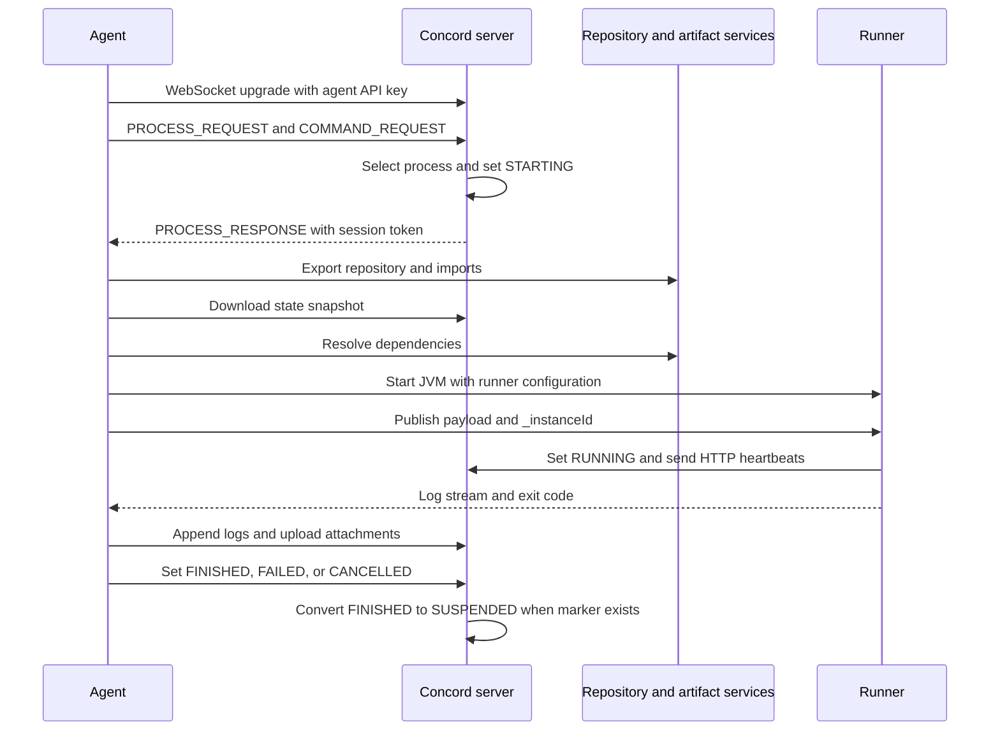

# Concord agent specification

## 1. Purpose and scope

This document specifies the Concord agent interfaces and the current Java agent behavior.
Use it to develop an alternative agent for the same Concord server and runners.

The source baseline is this repository, version `2.46.1-SNAPSHOT`, inspected on 2026-10-21.
There is no separate queue protocol version or capability negotiation for protocol versions.
Check these interfaces again when you change the Concord version.

This specification covers:

- Agent startup, configuration, and shutdown.
- Process acquisition, capability selection, and cancellation.
- Authentication, process state, repositories, imports, and dependencies.
- Runner startup, files, environment variables, and completion.
- Logs, attachments, suspension, and resume.
- Maintenance mode, prefork operation, and Docker cleanup.
- Known defects, implementation limits, and acceptance checks.

The Concord workflow languages and plugin APIs are separate interfaces.
An alternative agent can use the existing runner JARs without implementing those languages.
A replacement workflow engine must also implement the selected runtime and plugin interfaces.
Java-serialized process state is not a language-independent workflow format.

### 1.1 Requirement classes

| Label | Meaning |
| --- | --- |
| Contract | Behavior necessary for the stated server or runner interface. |
| Reference behavior | Behavior of the Java agent in this source baseline. An alternative can use a different internal design. |
| Recommendation | A safer implementation choice. This is not a claim about current behavior. |
| Defect | An implementation problem with source evidence. Section 15 separates smoke evidence from inspection evidence. |

The word **must** identifies a requirement of this specification.
The words **can** and **optional** identify a permitted choice.
Do not copy a defect only to reproduce the Java implementation.

### 1.2 Writing and technical terms

This document uses short sentences, active instructions, and consistent technical terms.
It follows the writing approach of [ASD-STE100 Simplified Technical English][ste].
Code identifiers, protocol names, and the technical terms below retain their software meanings.

| Technical term | Meaning in this document |
| --- | --- |
| agent | A service that accepts processes from a Concord server and controls their execution. |
| process | One Concord workflow instance, identified by a UUID. |
| runner | The operating-system process that executes a Concord workflow. |
| runtime | The workflow implementation selected for a process, such as `concord-v2`. |
| worker | One local execution controller for an assigned process. |
| slot | Local capacity for one worker. |
| payload directory | A temporary directory where the agent assembles process input. |
| work directory | The runner's current directory. Concord exposes it as `${workDir}`. |
| snapshot | The server's ZIP representation of saved process files. |
| attachment | A file below `_attachments` that the agent sends to the server. |
| prefork | A spare runner JVM that waits for process input. Each spare executes one assignment. |
| session token | An opaque credential for one Concord process. It is not the agent API key. |
| correlation ID | An integer that connects one queue response to one queue request. |
| segment | A named part of a process log, with a server-assigned numeric ID. |
| heartbeat | An HTTP request that updates the process activity time. |
| drain | Stop new assignments while existing workers continue. |
| overlay | Copy later files over an earlier directory tree. |

## 2. System boundaries



The diagram shows the assignment sequence, not a delivery guarantee.
A normal runner receives `_instanceId` before JVM startup.
A preforked runner receives it after JVM startup.

The server prepares process configuration and selects a process for an agent.
The agent assembles files, resolves dependencies, controls the runner, and sends final results.
The runner executes workflows, uses process APIs, sends heartbeats, and produces saved state.

The reference agent starts a JVM directly.
It does not automatically put the runner in a Docker container.
Docker tasks can start separate containers through the runner's Docker services.

Sources: [Agent][agent], [Worker][worker], [runner executor][executor], [process dispatcher][dispatcher].

## 3. Identity and authentication

### 3.1 Agent identity

Use a unique, canonical UUID string for the agent ID.
Use the same string in the WebSocket header, command request, runner configuration, and status query parameter.

The configuration comment permits an arbitrary string of up to 36 characters.
However, `CommandHandler` calls `UUID.fromString` on that string.
A non-UUID ID can stop agent initialization.
An uppercase UUID header can also disagree with the canonical string used for command selection.

If `id` is absent, the Java agent generates a UUID at startup.
It does not preserve that ID across restarts.

### 3.2 Agent API key

The agent must have a server-issued API key.
The Java configuration rejects an empty or blank `server.apiKey`.

Send the key exactly as supplied:

```http
Authorization: <agent-api-key>
```

Do not add `Bearer`, `Basic`, or another prefix to this header.
The WebSocket server checks Base64 syntax and looks up the complete key.
When `websockets.requirePermission` is enabled, the key's user also needs the agent WebSocket permission.

### 3.3 Process session token

`PROCESS_RESPONSE.sessionToken` supplies the credential for process-specific HTTP requests.
Send it as:

```http
X-Concord-SessionToken: <process-session-token>
```

The Java HTTP client uses this token when it is non-null.
Otherwise, it uses the agent API key.
Do not assume that the API key grants all process permissions.

The server also puts process credentials in `_main.json`.
Runtime v1 reads `processInfo.sessionKey`.
Runtime v2 reads `processInfo.sessionToken` and accepts `sessionKey` as a JSON alias.
The outer agent does not put the queue token into the generated runner configuration.
Preserve the server-generated process configuration, including its credentials.

Treat tokens as opaque secrets.
The server creates them from an encrypted process UUID; the creator does not add an expiry field.
This does not remove server authorization checks or guarantee access after process removal or server-key changes.

The reference HTTP client retains a `JSESSIONID` response cookie for later requests.
Its implementation copies the complete `Set-Cookie` value into a `Cookie` header.
An alternative HTTP client should use normal cookie parsing instead.

### 3.4 Transport security

The reference HTTP configuration defaults `server.verifySsl` to `false`.
The queue client separately sets `trustAll=true` for WebSocket TLS.
Changing `server.verifySsl` does not repair the WebSocket TLS behavior.

**Recommendation:** Verify certificates and hostnames for both HTTPS and WSS.
Restrict access to the maintenance listener and Docker endpoint.
Do not log API keys, session tokens, repository passwords, or private keys.

Sources: [server connection configuration][server-config], [command handler][commands], [API client factory][api-factory], [WebSocket authentication][ws-auth], [session-token creator][token-creator].

## 4. Queue protocol

### 4.1 Connection

The default URL is `ws://localhost:8001/websocket`.
A configured URL is a complete WebSocket URL, not an HTTP API base URL.
The configuration accepts a comma-separated list of URLs.

The upgrade request must include:

| Header | Value |
| --- | --- |
| `Authorization` | Agent API key, without an authentication scheme prefix. |
| `X-Concord-Agent-Id` | Agent UUID string. |
| `X-Concord-Agent` | Agent description. The default is `Concord-Agent: id=<agent-id>`. |

The reference client does not request a WebSocket subprotocol.
The server truncates long agent descriptions and escapes newline characters.

| Upgrade response | Meaning |
| --- | --- |
| `101` | WebSocket connection accepted. |
| `401` | Missing `Authorization` header. |
| `403` | Invalid key, unknown key, or insufficient WebSocket permission. |
| `503` | Server maintenance or shutdown. |

### 4.2 Message envelope

Send one JSON message as a WebSocket text message.
Do not use binary messages for queue requests.
An implementation must support normal WebSocket message fragmentation.

Every queue message has these fields:

| Field | JSON type | Rule |
| --- | --- | --- |
| `messageType` | String | One of the four names below. Case is significant. |
| `correlationId` | Integer | Signed 64-bit value. A response copies its request's value. |

Message names are `PROCESS_REQUEST`, `PROCESS_RESPONSE`, `COMMAND_REQUEST`, and `COMMAND_RESPONSE`.
Known messages ignore unknown JSON properties.
Missing or unknown message types cause deserialization failure.
There is no version field, process acknowledgment message, or command acknowledgment message.

The Java client starts correlation IDs at `1` and increments them across reconnects.
An alternative must not reuse an ID while its request is pending.
Register the pending request before sending it.
Unknown response IDs must not start processes.

### 4.3 Process request

```json
{
  "messageType": "PROCESS_REQUEST",
  "correlationId": 1,
  "capabilities": {
    "os": "linux",
    "pool": "general"
  }
}
```

`capabilities` is a JSON object.
The Java default is `{}`.
There are no automatically added runtime, operating-system, CPU, or memory capabilities.
Capability names have no built-in meaning in the queue client.

Keep a process request pending only when local capacity is available.
The reference client permits one outstanding request of each message type per connection.
The agent requests one process at a time, even when several slots are free.

The server holds an unmatched request.
It does not periodically return an empty process response.
A Java `Future` result of `null` is a local reconnect or maintenance result, not a wire message.

### 4.4 Capability selection

The server compares `requirements.agent` with the request's `capabilities`.
An absent, non-object, or empty `requirements.agent` matches any agent.
Other server filters can still prevent dispatch.
These include process readiness and concurrency controls.

For a nonempty requirement object, the shared matcher uses these rules:

1. Every required map key must match. Additional capability keys are permitted.
2. Nested maps use the same comparison.
3. A string requirement is a case-insensitive Java regular expression.
4. A string expression must match the complete capability value.
5. A missing or null capability becomes an empty string for a string requirement.
6. Two null values match. Other scalar values use typed equality.
7. A list requirement matches a scalar when at least one list item matches.
8. A scalar requirement matches a capability list when at least one capability item matches.
9. With two lists, every requirement item must match at least one capability item.
10. A requirement list cannot be longer than the capability list.

List items can match the same capability item more than once.
An empty nested map or list does not match a nonempty value.
The top-level empty-requirement shortcut is different from that nested rule.
There are no special `$and`, `$or`, or wildcard key operators.
An invalid regular expression enters the server's requirement-error path.

### 4.5 Process response

```json
{
  "messageType": "PROCESS_RESPONSE",
  "correlationId": 1,
  "processId": "11111111-1111-4111-8111-111111111111",
  "processCreatedAt": "2026-10-21T03:00:00.000Z",
  "sessionToken": "<opaque-process-token>",
  "orgName": "example",
  "repoUrl": "https://git.example/project.git",
  "repoBranch": "main",
  "commitId": "<commit-id>",
  "repoPath": "workflows",
  "secretName": "repository-key",
  "imports": {"items": []},
  "requirements": {"agent": {"pool": "general"}}
}
```

| Field | Type | Meaning |
| --- | --- | --- |
| `processId` | UUID string | Process identity. The agent calls it `instanceId` internally. |
| `processCreatedAt` | Timestamp string | Server creation time. Format: `yyyy-MM-dd'T'HH:mm:ss.SSSX`. |
| `sessionToken` | String | Process HTTP credential. |
| `orgName` | String or null | Organization for the repository secret. Not necessarily the process organization. |
| `repoUrl` | String or null | Main repository URL. |
| `repoBranch` | String or null | Requested branch. |
| `commitId` | String or null | Requested commit. |
| `repoPath` | String or null | Subdirectory to export. |
| `secretName` | String or null | Main repository secret name. |
| `imports` | Object or null | Normalized imports, as specified in section 7. |
| `requirements` | Object or null | Server-side process requirements. |

Null response fields can be omitted.
The Java job adapter does not retain `processCreatedAt` or the response's `requirements` map.
It reads execution requirements later from `_main.json`.
Do not substitute response requirements for that file.

The server sets `STARTING` and the agent ID before it sends the response.
There is no acquisition acknowledgment or lease-renewal message.
A failed response delivery can leave the process in `STARTING` until the watchdog acts.
Do not start the same assignment again merely because the queue connection reconnects.

### 4.6 Command request and response

Keep command acquisition active while runners execute and while the agent drains.

```json
{
  "messageType": "COMMAND_REQUEST",
  "correlationId": 2,
  "agentId": "22222222-2222-4222-8222-222222222222"
}
```

```json
{
  "messageType": "COMMAND_RESPONSE",
  "correlationId": 2,
  "type": "CANCEL_JOB",
  "payload": {
    "instanceId": "11111111-1111-4111-8111-111111111111"
  }
}
```

`agentId` is a UUID in the Java command model.
`CANCEL_JOB` is the only current command type.
`payload.instanceId` identifies the process to cancel.
There is no reply after command execution.

The server marks a command `SENT` after its delivery attempt.
This is not evidence that the agent applied it.
The reference agent ignores a cancellation for an unknown local process.
Section 11 describes cancellation during preparation and execution.

### 4.7 Connection maintenance and retry

The Java queue loop uses these agent defaults:

| Setting | Default | Effect |
| --- | --- | --- |
| Connect timeout | 30 seconds | Maximum wait for a connection attempt. |
| Request-loop delay | 1 second | Delay between queue loop iterations. At most one request is sent per iteration. |
| Ping threshold | 10 seconds | Send a WebSocket ping after this period without a sent data request. |
| No-activity threshold | 30 seconds | Reconnect after this period without a text response or pong. |
| Reconnect delay | 5 seconds | Wait before the next connection attempt. |

The ping body is `ping`; the server's pong body is `pong`.
The client does not inspect pong content.
Sending a ping does not update its last data-request time.
Thus, an idle connection can send pings every loop after the threshold.

On a connection exception, the client advances to the next configured URL.
On close, it completes pending local requests with `null` and clears queued requests.
Callers then submit new requests.
Already running processes continue independently of the queue connection.

Sources: [queue client][queue], [message definitions][messages], [WebSocket channel][ws-channel], [capability matcher][matcher], [process dispatcher][dispatcher], [command dispatcher][command-dispatcher].

## 5. Process HTTP interface

All paths below are relative to `server.apiBaseUrl`.
Use the process session token, unless a deployment explicitly supplies equivalent authorization.
Encode UUIDs and other path or query values correctly.

| Owner | Method and path | Request | Successful response |
| --- | --- | --- | --- |
| Agent | `GET /api/v1/process/{id}/state/snapshot` | No body. | `200`, `application/zip`. |
| Agent or runner | `POST /api/v1/process/{id}/status?agentId={agentId}` | `text/plain`; exact status name. | No response data required. |
| Runner | `POST /api/v1/process/{id}/ping` | No body. | No response data required. |
| Agent | `POST /api/v1/process/{id}/log` | `application/octet-stream`; legacy log bytes. | No response data required. |
| Runner v2 | `POST /api/v2/process/{id}/log/segment` | JSON segment description. | JSON with `ok`, `id`, and `result`. |
| Agent | `POST /api/v2/process/{id}/log/segment/{segmentId}/data` | `application/octet-stream`; segment bytes. | No response data required. |
| Agent | `POST /api/v2/process/{id}/log/segment/{segmentId}` | JSON segment status and counts. | JSON with `ok`, `id`, and `result`. |
| Agent | `POST /api/v1/process/{id}/attachment` | `application/octet-stream`; ZIP bytes. | No response data required. |
| Agent | `POST /api/v1/org/{org}/secret/{name}/data` | Multipart form; optional `storePassword`. | Secret bytes and `X-Concord-SecretType`. |

Status, attachment, log, and heartbeat handlers with no return value use the normal JAX-RS empty response.
Accept successful HTTP responses without requiring a JSON body.
Do not send JSON quotes around a `text/plain` status.

The state endpoint checks process access and filters session-only resources.
Use the process session token to obtain the complete execution snapshot.
The status endpoint permits the matching process session or an appropriate privileged identity.
Log endpoints apply their own process or log-access checks.
The attachment endpoint applies server attachment policy before it imports files.

### 5.1 Retry behavior

The agent's common retry helper makes one initial call and up to three retries.
The delay is 3 seconds for state, status, logs, and attachments.
HTTP `4xx` errors stop retries, including `408` and `429`.
Other HTTP failures and ordinary exceptions enter the retry path.
The helper also sleeps after the last failed attempt before it throws.

Repository secret retrieval uses three retries with a 5-second delay.
The runner has separate API retry settings.
The agent's `server.retryCount` and `server.retryInterval` configuration entries do not control these wrappers.

Append-log calls have no offset, request ID, or deduplication token.
A retry after an uncertain response can duplicate log bytes.
An alternative must account for this limit; it cannot promise exactly-once log delivery through these endpoints.

Sources: [process resource][process-http], [segment resource][segment-http], [retry helper][retry], [secret client][secret-client], [status updater][status-updater].

## 6. Assignment lifecycle and state ownership

### 6.1 Local capacity

The Java agent uses `workersCount` semaphore permits.
It reserves one permit before it waits for the next process response.
It registers a worker by process UUID before starting that worker.
It releases the permit and removes the worker when the completion callback runs.

The configured count limits local assignments, not CPU, memory, or Docker resource use.
There is no local durable assignment journal.
There is no automatic replay of a lost local worker after agent restart.

### 6.2 Preparation order

For each assignment, perform these operations in order:

1. Create a private payload directory.
2. Export the main repository when required.
3. Process normalized imports in their listed order.
4. Download and extract the server state snapshot over the payload.
5. Read `_main.json` from the resulting payload.
6. Select the runtime and resolve dependencies.
7. Start a runner or acquire a suitable prefork.
8. Collect output and wait for runner completion.
9. Upload attachments.
10. Report the final local result.
11. Release capacity and remove temporary process data.

Later state files replace earlier repository or import files.
Do not reverse the snapshot and repository operations.
A resume can depend on the saved versions of files.

The Java worker removes the original payload directory in a `finally` block.
The runner executor removes its work directory and local log file before the worker reports final status.
Cleanup failures produce warnings.

### 6.3 Status ownership

| Status or transition | Owner and condition |
| --- | --- |
| `ENQUEUED` to `STARTING` | Server dispatcher assigns the process to an agent. |
| `RUNNING` | Runner starts or resumes workflow execution. |
| `FINISHED` request | Agent completes execution and attachment upload without an error. |
| `FAILED` request | Preparation, startup, execution, or required attachment upload fails. |
| `CANCELLED` request | Execution fails after the local job handle records cancellation. |
| `FINISHED` to `SUSPENDED` | Server finds `_attachments/_state/_suspend` in saved state. |
| Timeout or stale-process failure | Server watchdog and timeout controls. |

A zero runner exit code is not sufficient for `FINISHED`.
The successful attachment upload must also complete.
A suspended workflow normally exits successfully; its saved marker changes the server result.

The server ignores a later `CANCELLED` update when the process is already in a terminated state.
It does not apply the same guard to every possible status update.
Do not assume a general compare-and-set status protocol.

The server starts configured failure, cancellation, and timeout handlers as separate child processes.
The outer agent must not run these handlers a second time.

### 6.4 Heartbeat and watchdog

The existing runners send a heartbeat immediately, then sleep 10 seconds between attempts.
The interval includes HTTP call time.
A WebSocket pong is not a process heartbeat.

After repeated heartbeat failure, the runner compares the elapsed time with `api.maxNoHeartbeatInterval`.
The agent supplies a default limit of 5 minutes.
When a failed attempt exceeds the limit, the runner calls `System.exit(1)`.

The server has separate defaults:

| Server control | Default |
| --- | --- |
| Process watchdog period | 3 seconds. |
| Stalled `RUNNING` age | 1 minute. |
| Failed-start age for `PREPARING`, `STARTING`, and `RESUMING` | 10 minutes. |

These are age thresholds, not exact failure times.
Server polling and backlog can delay action.
The server can fail a process before the runner's 5-minute local limit expires.
An alternative that uses the existing runners must not replace their heartbeats with queue pings.

Sources: [Worker][worker], [process manager][process-manager], [heartbeat implementation][heartbeat], [server defaults][server-defaults], [watchdog][watchdog].

## 7. Repositories, imports, and snapshots

### 7.1 Main repository

Skip the main repository export when any of these conditions applies:

- `repoUrl` is null.
- Both `commitId` and `repoBranch` are null.
- `repoUrl` starts with `classpath://`.

The `git.skip` configuration also bypasses repository-manager export.
This bypass applies to exports through that manager, not only one Git command.

Otherwise, fetch the specified commit and branch into the repository cache.
Export `repoPath`, or the selected repository root, into the payload.
The reference manager supports Git CLI and Maven repository providers.
It uses the repository URL as the cache key and locks cache operations.
It runs cache cleanup after a successful export.

Use `orgName` and `secretName` for the main repository secret.
The main response has no secret-password field.
A supplied import secret can have a password.

### 7.2 Import wire format

Queue imports are normalized objects, not the original project YAML syntax.

```json
{
  "items": [
    {
      "type": "git",
      "url": "https://git.example/shared.git",
      "version": "main",
      "path": "flows",
      "dest": "shared",
      "exclude": [".*\\.tmp"],
      "secret": {"org": "example", "name": "repository-key"}
    },
    {
      "type": "mvn",
      "url": "mvn://example:workflow-library:zip:1.0.0",
      "dest": "library"
    }
  ]
}
```

A missing or null imports object becomes an empty list in the Java job adapter.
The common import serializer can omit an empty `items` list.

| Type | Fields | Behavior |
| --- | --- | --- |
| `git` | Optional `name`, `url`, `version`, `path`, `dest`, `secret`; `exclude` defaults to `[]`. | Export through the repository manager. The server normally supplies normalized URL and version data. |
| `mvn` | Required `url`; optional `dest`. | Resolve an artifact and extract its ZIP content. |
| `dir` | Required `src`; optional `dest`. | Copy a local directory. Disabled by default. |

An import secret has `name`, optional `org`, and optional `password`.
The server normalizes project-specific import data before dispatch.
Execute imports in `items` order.
An unknown or disabled processor fails preparation.

A missing `dest` means the payload root.
Git export receives `exclude` patterns.
The common file-copy helper uses full-string Java regular expressions on relative paths, not shell globs.
Git, directory, and Maven imports replace colliding regular files.
Git export also excludes root `.git`, `.gitmodules`, and `.gitignore` paths.
The shared copy helper preserves permitted symbolic links but does not copy empty directories.

The local-directory processor checks `workDir.startsWith(src)`.
This rejects the work directory and its ancestors, but does not reject all descendants.
Its error text describes a stronger external-directory rule than the actual predicate.

The import adapters do not consistently constrain `dest` to the payload directory.
**Recommendation:** Reject absolute or escaping destinations in an alternative implementation.
Declare this security restriction if existing projects depend on unsafe paths.

### 7.3 Repository authentication

The token-provider order is:

1. GitHub App installation provider.
2. OAuth token provider.

The first provider that reports support supplies the result.
An empty result does not make the agent try the next provider.
Explicit repository secrets and provider-specific rules determine the selected credential.

The nested `ConcordServerTokenProvider` is not implemented.
It always reports no support and returns no token.
It is not in the active provider list.
Do not specify server-fetched external repository tokens as a working agent feature.

### 7.4 Secret data format

Request decrypted secret data through the HTTP endpoint in section 5.
The multipart password field is `storePassword`.
The response header `X-Concord-SecretType` determines the binary format.

| Secret type | Body format |
| --- | --- |
| `DATA` | Raw secret bytes. |
| `KEY_PAIR` | Big-endian 32-bit public-key length, public-key bytes, private-key length, private-key bytes. |
| `USERNAME_PASSWORD` | Java `DataOutput.writeUTF` username, then big-endian 32-bit password byte length and UTF-8 password bytes. |

`writeUTF` uses Java modified UTF-8 with an unsigned 16-bit byte-length prefix.
It is not an ordinary UTF-8 string with a 32-bit length.
The Java key-pair decoder rejects each key length outside `0..8192`.
A `404` becomes a secret-not-found error.
A missing secret-type header also fails retrieval.

An alternative must preserve secret access checks and must not store decrypted values in a shared repository cache.

### 7.5 Snapshot extraction

Extract the downloaded ZIP into the existing payload with replacement enabled.
The reference ZIP service applies these limits:

| Limit | Default |
| --- | --- |
| Entry count | 10,000. |
| Total uncompressed bytes | 1,073,741,824. |
| Uncompressed bytes per entry | 268,435,456. |
| Compression ratio per entry | 200. |

The extractor checks advertised sizes and actual bytes.
It skips entries whose normalized paths escape the destination.
It applies the compression-ratio check when the compressed size is positive.
Entry permissions come from the ZIP Unix mode, with defaults when needed.
It does not restore archive entries as symbolic links.

The lexical path check does not prove safety through an existing symbolic-link component.
Repository data can exist before extraction.
**Recommendation:** Prevent extraction through symbolic links outside the private payload root.

Sources: [repository manager][repositories], [import definitions][imports], [import execution][import-manager], [directory imports][directory-import], [path operations][paths], [ZIP implementation][zip], [token providers][repo-auth], [secret formats][secret-formats].

## 8. Payload files and dependencies

### 8.1 File contract

Paths in this table are relative to the work directory.
Preserve unknown server-supplied files.
The agent must not limit a snapshot to this list.

| Path | Purpose |
| --- | --- |
| `_main.json` | Effective process configuration. This is not named `configuration.json`. |
| `_instanceId` | UUID text. Publication starts a waiting runner. |
| `_agent.json` | Optional local agent parameters; currently `jvmArgs`. |
| `lib/` | Process-supplied libraries. Its existence disables prefork use. |
| `.concord/policy.json` | Effective policy, including dependency rules. |
| `.concord/dependencyversions.properties` | Legacy default dependency versions. |
| `_attachments/_session_files/sensitive_data.json` | Runtime v2 saved sensitive-data values. |
| `.extraDockerVolumes` | Agent-generated extra Docker volume list, when nonempty. |
| `_attachments/` | Root of files uploaded after execution. |
| `_attachments/_state/instance` | Runtime-serialized process state. |
| `_attachments/_state/_suspend` | Waiting event names, one per line. |
| `_attachments/_state/_resume` | Resume event names. |
| `_attachments/_session_files/` | Session-only files. |
| `_attachments/out.json` | Exported process output variables. |
| `_checkpoints/` | Runtime checkpoint data. Checkpoint upload is separate from ordinary attachment upload. |

Project YAML, resource files, flow definitions, and runtime-specific files can also be present.
The runtime consumes them; the outer agent does not implement workflow parsing.

### 8.2 Process configuration used by the agent

| `_main.json` key | Agent behavior |
| --- | --- |
| `runtime` | Select a configured runtime. Default: `concord-v1`. Unknown names fail startup. |
| `debug` | Boolean, or a string parsed as a boolean. Default: `false`. |
| `runner` | Initial runner configuration. Agent-controlled fields replace selected values. |
| `dependencies` | Collection of dependency URI strings. |
| `requirements.jvm.extraArgs` | Nonempty JVM argument list, unless `_agent.json` supplies `jvmArgs`. |

The agent reads `_main.json` twice in the current path.
An absent file produces an empty map during agent preparation.
This does not make the file optional for authenticated workflow execution.
The existing runners need its process configuration and session credential.
Malformed JSON fails preparation.

### 8.3 Dependency procedure

1. Read the default dependency list.
2. Read and normalize process dependency URIs.
3. Replace process Maven `latest` versions when a default version is available.
4. Apply the dependency-rewrite policy.
5. Resolve artifacts and their required dependencies.
6. Apply dependency warning and denial rules.
7. Fail startup if the policy denies a resolved artifact.
8. Sort absolute artifact paths and put them in the runner configuration.

The packaged default dependencies are:

```text
mvn://com.walmartlabs.concord.plugins.basic:concord-tasks:<agent-build-version>
mvn://com.walmartlabs.concord.plugins.basic:slack-tasks:<agent-build-version>
mvn://com.walmartlabs.concord.plugins.basic:http-tasks:<agent-build-version>
```

`DEFAULT_DEPS_CFG` replaces the packaged list with a local file.
Each nonblank line is a URI.
There is no comment syntax or trimming step in this reader.

Process dependency normalization removes duplicate URIs.
Maven URIs use the `mvn` scheme.
The artifact forms are `mvn://group:artifact:version` and `mvn://group:artifact:extension[:classifier]:version`.
Process dependency queries support `scope`, `transitive`, and repeated `exclude` values.
The defaults are `scope=compile` and `transitive=true`.
Use `key=value` query pairs; a bare flag is not supported.
Version replacement for `latest` rebuilds the URI from its authority and can discard query options.

A URL ending in `.jar` passes directly to the resolver.
Other HTTP or HTTPS URLs follow `301`, `302`, `303`, and `307` redirects during normalization.
This normalization has no explicit redirect limit or connection timeout.
It does not support relative `Location` values through URL resolution.

For Maven `latest`, `.concord/dependencyversions.properties` supplies artifact-version pairs.
The `dependencyVersions` policy overrides matching file entries.
An unresolved `latest` value remains in the URI and produces a warning when applicable.
Policy rewrite then applies to the combined default and process URI list.

The default dependency-resolution timeout is 10 minutes.
It covers dependency preparation through the executor's future, not total workflow execution.
The executor requests interruption on timeout; blocked external I/O need not stop immediately.

`CONCORD_MAVEN_CFG` selects a JSON Maven repository configuration with a `repositories` list.
Without a usable file, the manager uses Maven Central with snapshots disabled.
A malformed existing file fails configuration loading.
`dependencyStrictRepositories=true` excludes repositories supplied by artifact descriptors.

Sources: [file constants][files], [configured job][configured-job], [runner job][runner-job], [dependency normalization][dependencies], [artifact resolver][artifact-resolver], [default dependency list][default-deps], [dependency manager configuration][dependency-config], [Maven repositories][maven-repositories], [sensitive-data persistence][sensitive-data].

## 9. Runner interface

### 9.1 Runtime selection

| Runtime | Main class | Default segmented logs |
| --- | --- | --- |
| `concord-v1` | `com.walmartlabs.concord.runner.Main` | `false` |
| `concord-v2` | `com.walmartlabs.concord.runtime.v2.runner.Main` | `true` |

Each runtime entry specifies a local runner JAR, Java command, JVM arguments, and configuration directory.
The current repository build requires Java 25.
Use runner and plugin artifacts compatible with the selected server version.

The agent selects a runner from `_main.json.runtime`.
Project-loader code also reads runtime information from project YAML.
Preserve agreement between server-generated configuration and project files.

### 9.2 Runner configuration JSON

The generated runner configuration is separate from `_main.json`.
Start with the process's `runner` object, then apply these overrides:

| Field | Agent-supplied value |
| --- | --- |
| `agentId` | Agent UUID string. |
| `debug` | Effective process debug flag. |
| `api.baseUrl` | Agent's server API base URL. |
| `api.maxNoHeartbeatInterval` | Agent's heartbeat-failure limit, in milliseconds. |
| `docker.extraVolumes` | Agent's extra Docker volume list. |
| `docker.exposeDockerDaemon` | Agent's Docker exposure setting. |
| `dependencyManager.cacheDir` | Absolute dependency-cache path. |
| `logging.sendSystemOutAndErrToSLF4J` | `true`. |
| `logging.segmentedLogs` | Selected runtime setting. |
| `logging.workDirMasking` | Agent work-directory masking setting. |
| `dependencies` | Sorted absolute paths of resolved artifacts. |

The agent replaces the `api`, `docker`, `dependencyManager`, and `logging` objects.
It does not merge their individual user-supplied fields.
Thus, runner API timeouts use their schema defaults, not the agent's HTTP timeout values.

Runner API defaults are `connectTimeout=10000`, `readTimeout=60000`, `writeTimeout=30000`, `retryCount=3`, and `retryInterval=5000`.
Time values are milliseconds.
Other runner fields include `enableSisuIndex`, `logLevel`, and `securityManager`.
The schema ignores unknown runner configuration keys.
Runtime v2 always enables the Sisu index; `logLevel` is a legacy v1 setting.

The Java agent writes pretty-printed JSON to `<cfgDir>/<sha256-of-json>.json`.
It reuses an existing file with that name.
This naming scheme is an optimization, not a runner requirement.
The runner requires a readable configuration path as its first argument.

### 9.3 JVM argument selection

Select the first applicable source:

1. `_agent.json.jvmArgs`, when non-null.
2. `_main.json.requirements.jvm.extraArgs`, when nonempty.
3. The selected runtime's `jvmParams`.

An empty `_agent.json.jvmArgs` list suppresses the default JVM arguments.
An empty `requirements.jvm.extraArgs` list does not suppress them.
The selected list replaces defaults; it is not appended to them.

The default list is:

```text
-Xmx128m
-XX:+HeapDumpOnOutOfMemoryError
-XX:+ExitOnOutOfMemoryError
-XX:HeapDumpPath=/tmp
```

The builder adds the following arguments after the selected list:

```text
-client
-Djavax.el.varArgs=true
-Djava.security.egd=file:/dev/./urandom
-Djava.net.preferIPv4Stack=true
-Dsun.zip.disableMemoryMapping=true
-Dfile.encoding=UTF-8
-Dconcord.exposeDockerDaemon=<true-or-false>
-Dpolyglot.engine.WarnInterpreterOnly=false
--add-opens java.base/java.lang=ALL-UNNAMED
--add-opens java.base/java.util=ALL-UNNAMED
--enable-native-access=ALL-UNNAMED
```

It also adds `-DlogLevel=<uppercase-level>` when present.
When extra Docker volumes exist, it adds `-Dconcord.dockerExtraVolumes=.extraDockerVolumes`.
For Java 23 or later, it adds `--sun-misc-unsafe-memory-access=allow`.
It obtains the target Java major version by running the configured Java command.

The command ends with:

```text
-cp <absolute-runner-jar> <runtime-main-class> <absolute-runner-config-json>
```

Process dependencies are in the configuration, not this initial Java classpath.
The runner loads them through its runtime classloader.
The builder supports `-Duser.dir`, but the executor uses the operating-system current directory instead.

### 9.4 Environment and streams

Set the runner's current directory to its work directory.
The reference launcher inherits the agent environment and adds:

| Environment variable | Value |
| --- | --- |
| `CONCORD_TMP_DIR` | Absolute common temporary directory. |
| `_CONCORD_ATTACHMENTS_DIR` | Absolute work-directory `_attachments` path. |
| `CONCORD_DOCKER_LOCAL_MODE` | Parent value, when present. |

Runtime v2 also honors inherited `RUNNER_AGENT_ID` and `RUNNER_API_BASE_URL` overrides.
These can override values from the generated runner configuration.

Merge runner stderr into stdout and collect the complete stream.
The agent does not send a startup command through stdin.
There is no agent-to-runner socket protocol in this path.

### 9.5 Work directory and startup marker

Without prefork, the work directory is `<workDirBase>/<process-id>`.
The Java agent creates that destination, moves the payload with `ATOMIC_MOVE`, writes `_instanceId`, and starts Java.
There is no fallback when the atomic move is unsupported.
Keep the payload and work-directory locations on a compatible filesystem when using the reference agent.
A stale nonempty destination can also prevent startup.

With prefork, the agent copies the payload into the spare's temporary directory.
It writes `_instanceId` only after the copy completes.
The file contains UUID text without a required newline.
The reference write uses `CREATE` and `SYNC`.

Both runners wait for a valid `_instanceId` before loading process input.
Runtime v1 polls approximately every 100 milliseconds.
Runtime v2 polls approximately every second.
The wait has no configured timeout.

**Contract:** Do not publish `_instanceId` before all required payload files are ready.
A replacement can publish this marker atomically to avoid a partial UUID read.

### 9.6 Prefork behavior

Prefork use requires all of these conditions:

- `prefork.enabled=true`.
- No `lib` path in the payload.
- No nonempty process JVM argument list.
- No `_agent.json` file.

The pool key hashes the complete command argument sequence.
The command includes the hashed runner-configuration path.
Thus, dependency paths and runner settings indirectly affect reuse.

A taken spare is not returned to the pool after execution.
The pool starts a replacement spare asynchronously.
A background thread checks for expired or marked entries every 30 seconds.

The default maximum spare age is 30 seconds; the default count is three.
The count is not a strict instantaneous bound.
The current pool marks the oldest entry for later removal, then starts another spare.
It does not check a spare's age, removal flag, or process liveness when taking it.

Prefork work-directory paths are temporary and can change across resume.
Without prefork, consistent absolute `workDirBase` values help preserve `${workDir}` across agents.
Neither mode makes a saved local file path portable without the corresponding saved file.

Sources: [runtime configuration][runtime-config], [runner configuration schema][runner-config], [runner API schema][runner-api], [command builder][command-builder], [runner executor][executor], [process pool][pool], [v1 runner][v1], [v2 configuration provider][v2-config].

## 10. Logs

### 10.1 Collection and local storage

Agent preparation messages use the process log API directly.
Runner output uses a local `system.log` file below `<logDir>/<process-id>`.
A separate stream reader sends chunks of up to 8192 bytes.
It waits up to `logMaxDelay` between short reads; the default is 2 seconds.

The file has no local rotation or size limit in this path.
The executor waits up to one minute per log-stream completion wait.
It then removes the local log file during cleanup.

`REDIRECT_PROCESS_LOGS_TO_STDOUT=true` adds an agent-stdout destination for the combined log appender.
This can expose process output in container or host logs.

### 10.2 Legacy logs

For an unsegmented runtime, send raw output bytes to the v1 log endpoint.
Do not wrap them in JSON or Base64.
After retries fail, the reference remote appender logs a warning and discards the chunk.

### 10.3 Segmented runner stream

A segmented record consists of an ASCII header followed immediately by body bytes:

```text
|<length>|<segmentId>|<status>|<warnings>|<errors>|<body>
```

The first `|` is required.
`length` counts body bytes, not Unicode characters.
There is no required newline between records.
The body can contain `|` bytes because its length defines its end.

| Field | Representation |
| --- | --- |
| `length` | Nonnegative decimal integer, parsed as Java `int`. |
| `segmentId` | Nonnegative decimal integer, parsed as Java `long`. |
| `status` | Numeric status from the table below. |
| `warnings` | Nonnegative decimal integer. |
| `errors` | Nonnegative decimal integer. |

| Wire status | Runtime name | HTTP status |
| --- | --- | --- |
| `0` | `RUNNING` | `RUNNING` |
| `1` | `OK` | `OK` |
| `2` | `SUSPENDED` | `SUSPENDED` |
| `3` | `ERROR` | `FAILED` |

Example with five ASCII body bytes:

```text
|5|42|0|0|0|hello
```

A non-`RUNNING` record with a body length of at most 20 is a status-time marker.
Its body contains an ASCII epoch-millisecond timestamp, not log text.
A zero-length marker supports older runners without a timestamp.
An invalid timestamp becomes an absent status time.
A non-`RUNNING` record with a longer body retains that body as log text.

Headers and bodies can cross read-chunk boundaries.
The consumer retains partial headers and partial status-time markers.
It can stream part of a normal body before the complete body arrives.
Unrecognized bytes become system-segment data with ID `0`.

Within a chunk, the consumer groups records by segment ID.
It appends each segment's body bytes and sends a separate statistics update.
It selects the last non-running status and the latest nonzero warning and error counts.
The counts are not summed across records in that chunk.

### 10.4 Segment HTTP operations

The runner creates non-system segments before it emits their output.
The agent does not create them from the stdout header.

Creation example:

```json
{
  "correlationId": "33333333-3333-4333-8333-333333333333",
  "name": "Run task",
  "createdAt": "2026-10-21T03:00:00.000Z"
}
```

`name` is required.
`correlationId` and `createdAt` are optional.
The response has this form:

```json
{"ok": true, "id": 42, "result": "CREATED"}
```

Append body bytes to the segment-data endpoint.
Send statistics to the segment-update endpoint:

```json
{
  "status": "OK",
  "warnings": 0,
  "errors": 0,
  "statusUpdatedAt": "2026-10-21T03:00:01.000Z"
}
```

Update fields are nullable.
The timestamp format is `yyyy-MM-dd'T'HH:mm:ss.SSSX`.
The server uses request time when no status time is supplied.
The update response uses `result: "UPDATED"`.
Append and update operations do not create segment metadata.

### 10.5 Masking, failures, and limits

The agent enables runtime work-directory masking by default.
Runtime log layout can replace the actual work directory with `$WORK_DIR`.
This is not a general guarantee that all raw subprocess bytes are sanitized.
Sensitive-data handling belongs partly to the runtime logging implementation.

A parser exception can stop the log-stream task and kill the runner.
Numeric header overflow and invalid status codes can cause such exceptions.
A plausible header prefix at final EOF can remain buffered without a final flush.

The segmented appender returns success or failure after HTTP retries.
The consumer ignores that result for both data and statistics.
There is no persistent resend queue.
Log delivery is best effort, not lossless.

Both server append paths enforce the server process-log size limit.
Reaching the limit can cause the server to cancel the process.
The local buffering file does not independently enforce that limit.

Sources: [log factory][log-factory], [redirected log][redirected-log], [header parser][header-parser], [segmented consumer][segmented-consumer], [remote appender][remote-log], [segment HTTP resource][segment-http].

## 11. Completion, cancellation, and saved state

### 11.1 Completion procedure

1. Drain the runner's stdout and stderr stream.
2. Wait for the runner's exit status.
3. Treat a nonzero exit status as execution failure.
4. Finish pending log transmission within the implementation's shutdown limit.
5. Upload `_attachments`, when it exists.
6. Report the final result with the process session token.
7. Remove private execution data and release the slot.

The Java executor attempts attachment upload after execution failure too.
It ignores a second attachment-upload error on that failure path.
After successful execution, an attachment-upload error makes the job fail.
Startup failure before a runner entry exists does not use the same attachment-upload path.

The status updater warns and returns after its HTTP retries fail.
The worker still releases local capacity.
Thus, local completion does not prove that the server received the final status.

### 11.2 Attachment ZIP

ZIP the contents of `_attachments`, not an extra `_attachments` parent directory.
For example, the ZIP contains `_state/instance`, not `_attachments/_state/instance`.

The server extracts the ZIP, checks attachment policy, and imports it below the process's `_attachments` path.
Before import, it deletes the old `_attachments/_state` directory.
It updates process output metadata from `out.json`.
This is not a complete replacement of every older attachment path.

Upload attachments before requesting `FINISHED`.
The server's suspension decision depends on the uploaded `_suspend` marker.

### 11.3 Suspension and resume

The runtime writes serialized state under `_attachments/_state`.
A suspended result has `_suspend` with waiting event names.
A resume snapshot includes `_resume` with event names to resume.
The agent must preserve these files and pass them to the matching runner.

The runtime removes resume and old suspend markers when it finalizes a new suspended state.
On normal completion, shared runtime cleanup removes state and session-only files.
The agent does not deserialize workflow state or choose resume events.

A later assignment for the same process can run on another agent.
It follows the same repository, import, snapshot, dependency, and runner procedure.
Runtime v1 and v2 state formats are not interchangeable.
Keep serialized state compatible with the runtime and plugin versions that read it.

Checkpoint upload is a runtime API operation, separate from final attachment collection.
Using the existing runners preserves that behavior without a second outer-agent checkpoint protocol.

### 11.4 Cancellation

The Java worker has no job handle during repository, import, snapshot, and dependency preparation.
`Worker.cancel()` returns immediately when that handle is null.
It does not retain a pending cancellation.

After a job handle exists, cancellation marks it cancelled and stops the runner process.
The stop helper requests normal termination, waits, then repeatedly requests forced termination.
It can wait indefinitely if the operating system still reports the process alive.
The cancellation flag affects failure reporting; a normally completed future can still produce `FINISHED`.

`cleanRunnerDescendants=true` does not reliably remove all children.
The helper collects direct children, then kills their descendants, but omits those direct children themselves.
Section 15 records a live reproduction.

**Recommendation:** Retain cancellation from assignment through cleanup.
Stop preparation work, the runner, and the complete owned process tree.
Do not terminate unrelated host processes or another agent's containers.

Sources: [executor][executor], [attachment uploader][attachments], [process resource][process-http], [state manager][state-manager], [process manager][process-manager], [kill helper][kill-helper].

## 12. Startup, maintenance, and shutdown

### 12.1 Service mode

Run `com.walmartlabs.concord.agent.Main` without arguments for service mode.
Guice and Sisu create the configured services.
The agent starts a command handler, process-acquisition loop, maintenance listener, and optional Docker sweeper.
The runtime configuration is loaded eagerly.

The distributed `start.sh` supplies runner JAR paths and the agent classpath.
It defaults `CONCORD_TMP_DIR` to `/tmp` and agent JVM options to `-Xmx256m`.
It sets UTF-8 encoding, IPv4 preference, logging configuration, and `-Dconcord.conf`.
These agent JVM options are separate from runner JVM options.

### 12.2 One-shot mode

Pass exactly one argument containing a complete `ProcessResponse` JSON object.
Do not pass a filename or a queue message stream.

One-shot mode creates a temporary payload, then uses the normal worker pipeline.
It still needs server access, credentials, state, repositories, and runtime configuration.
It is not an offline local-workflow mode.

A successful worker run exits with code `0`.
A caught worker exception exits with code `1`.
The same final-status retry limitation applies.
More than one argument causes an argument error.

The comment in `Main` says one-shot mode uses the current directory as `${workDir}`.
The implementation does not do that; it uses the normal payload and executor paths.

### 12.3 Maintenance HTTP interface

The listener defaults to `localhost:8010`.
It has no authentication or TLS in this implementation.

| Request | Result |
| --- | --- |
| `GET /maintenance-mode` | Return current state. |
| `POST /maintenance-mode` | Enable maintenance and return current state. No body is required. |
| Other methods at that context | `404`, body `404 (Not Found)` plus newline. |

Successful response:

```json
{"maintenanceMode": true, "workersAlive": 2}
```

The response type is `application/json`.
`workersAlive` is `workersCount - availablePermits`.
It can include a slot reserved for a pending process request.
It is not an exact count of operating-system runner processes.

Maintenance stops new process acquisition but keeps existing work and command acquisition active.
The queue client disconnects once, reconnects, and ignores later process requests.
The state cannot be disabled through this API.
Restart the agent to leave maintenance mode.

The HTTP server uses prefix-context matching.
A path such as `/maintenance-mode/suffix` reaches the same handler.
A listener bind failure produces a warning; the agent can continue without the endpoint.

### 12.4 Shutdown

The Java shutdown hook calls `Agent.stop()`.
That method stops the queue thread and interrupts the agent executor.
It does not perform a complete graceful runner drain.
It does not explicitly close all worker executors, the prefork pool, or the maintenance listener.

**Recommendation:** Enter maintenance, wait for local work to finish, then stop the service.
A replacement must define how forced shutdown terminates runners and preserves final output.
Do not equate `SIGTERM` receipt with successful final-status delivery.

### 12.5 Docker cleanup

The optional orphan sweeper runs `docker ps -a` for containers with the `concordTxId` label.
It removes a container when its process UUID is absent from this agent's active-worker map.
Removal uses `docker rm -f`.
The default period is 15 minutes; error retry delay is 30 seconds.
The first scan does not wait for the full period.

The sweeper uses the Docker CLI environment.
It does not apply `docker.host` from the agent configuration to its `ProcessBuilder`.
The reference also does not identify container ownership by agent ID.
Do not enable this sweeper against a daemon shared by independent agents.

Its map keeps only one container ID for each process UUID in a scan.
Its command helper waits for process exit before draining stdout.
Large command output can therefore block the helper.

Sources: [Main][main], [one-shot runner][one-shot], [maintenance listener][maintenance], [Agent][agent], [container startup][start-script], [orphan sweeper][sweeper].

## 13. Configuration reference

### 13.1 Loading and path rules

The root HOCON object is `concord-agent`.
The loader starts with `concord-agent.conf` and Typesafe Config defaults.
It overlays the file named by `-Dollie.conf`, then the file named by `-Dconcord.conf`.
The later external file takes precedence.
Each external file must contain the `concord-agent` object.
The loader then resolves substitutions.

Path handling is not ordinary relative-path handling:

- A configured value starting with `/` is an absolute path. The agent creates the directory when absent.
- Another value is a temporary-directory prefix under `CONCORD_TMP_DIR`.
- A missing directory setting also creates a temporary directory.
- Java's temporary-directory API adds a random suffix.

Thus, `dependencyCacheDir="dependencyCache"` does not mean a stable `/tmp/dependencyCache` directory.
Use absolute paths for stable shared locations.
`persistentWorkDir` must be absolute when set.
`CONCORD_TMP_DIR` falls back to Java's temporary directory outside the container startup script.

### 13.2 Agent settings

All keys below are relative to `concord-agent`.

| Key | Default | Meaning |
| --- | --- | --- |
| `id` | Generated UUID; `AGENT_ID` override. | Agent identity. Use a canonical UUID. |
| `capabilities` | `{}` | Values advertised in process requests. |
| `workersCount` | `3`; `WORKERS_COUNT` override. | Maximum local worker slots. |
| `payloadDir` | `payload` | Temporary-directory prefix. |
| `workDirBase` | `/tmp/concord-agent/workDirs`; `WORK_DIR_BASE` override. | Base for non-prefork work directories. |
| `dependencyCacheDir` | `dependencyCache` | Dependency-cache directory prefix. |
| `dependencyListsDir` | `dependencyLists` | Parsed and passed to executor configuration; no list-writing operation in the current executor. |
| `dependencyResolveTimeout` | `10 minutes` | Dependency preparation timeout. |
| `dependencyStrictRepositories` | `false` | Restrict Maven repositories to configured repositories. |
| `dependencyExclusions` | `[]` | Dependency exclusion patterns. |
| `explicitlyResolveV1Client` | `true` | Request explicit resolution of the v1 Concord client. |
| `mavenOfflineMode` | `false` | Maven offline operation. |
| `logDir` | `logs` | Local log directory prefix. |
| `logMaxDelay` | `2 seconds` | Delay for local log-file polling. |
| `workDirMasking` | `true` | Enable runtime work-directory masking. |
| `pollInterval` | `2 seconds` | Delay after a null command result. Command exceptions instead use a fixed 5-second delay. |
| `maintenanceModeListenerHost` | `localhost` | Maintenance bind address. |
| `maintenanceModeListenerPort` | `8010`; `MM_PORT` override. | Maintenance port. |
| `prefork.enabled` | `false` | Permit spare JVMs. |
| `prefork.maxAge` | `30 seconds` | Spare age threshold. |
| `prefork.maxCount` | `3` | Spare-count target. Not a strict bound. |

### 13.3 Server settings

| Key below `server` | Default | Meaning |
| --- | --- | --- |
| `apiBaseUrl` | `http://localhost:8001`; `SERVER_API_BASE_URL` override. | HTTP API origin. |
| `websocketUrl` | `ws://localhost:8001/websocket`; `SERVER_WEBSOCKET_URL` override. | Comma-separated queue URLs. |
| `websockerUrl` | Absent. | Legacy misspelling. Takes precedence when present. |
| `apiKey` | Empty; `SERVER_API_KEY` override. | Required agent API key. |
| `verifySsl` | `false` | Agent HTTP certificate verification; not WebSocket verification. |
| `connectTimeout` | `30 seconds` | Agent HTTP and queue connection timeout. |
| `readTimeout` | `1 minute` | Agent HTTP read timeout. |
| `retryCount` | `5` | Present in defaults but not read by `ServerConfiguration`. |
| `retryInterval` | `30 seconds` | Present in defaults but not read by `ServerConfiguration`. |
| `userAgent` | `Concord-Agent: id=<id>`; `USER_AGENT` override. | HTTP and queue agent description. |
| `websocketPingInterval` | `10 seconds` | Queue idle-ping threshold. |
| `websocketMaxNoActivityPeriod` | `30 seconds` | Queue receive-inactivity threshold. |
| `maxNoHeartbeatInterval` | `5 minutes` | Runner's local heartbeat-failure limit. |
| `processRequestDelay` | `1 second` | Queue loop delay. |
| `reconnectDelay` | `5 seconds` | Queue reconnect delay. |

### 13.4 Docker, ZIP, and repository cache

| Key | Default |
| --- | --- |
| `docker.host` | `tcp://127.0.0.1:2375`; `DOCKER_HOST` override. The distributed image sets `DOCKER_HOST=tcp://dind:2375`. |
| `docker.orphanSweeperEnabled` | `false`. |
| `docker.orphanSweeperPeriod` | `15 minutes`. |
| `docker.extraVolumes` | `[]`. |
| `docker.exposeDockerDaemon` | `true`. |
| `zip.unzipLimits.maxEntries` | `10000`. |
| `zip.unzipLimits.maxTotalUncompressedBytes` | `1073741824`. |
| `zip.unzipLimits.maxEntryUncompressedBytes` | `268435456`. |
| `zip.unzipLimits.maxCompressionRatio` | `200`. |
| `repositoryCache.cacheDir` | Generated temporary directory. |
| `repositoryCache.cacheInfoDir` | Generated temporary directory. |
| `repositoryCache.lockTimeout` | `3 minutes`. |
| `repositoryCache.lockCount` | `8`. |
| `repositoryCache.maxAge` | `1 day`. |

The executor does not explicitly export the parsed `docker.host` value to the runner environment.
Inherited `DOCKER_HOST` remains important.
Use consistent Docker configuration for the agent, runner, and task containers.

### 13.5 Git and import settings

| Key below `git` | Default |
| --- | --- |
| `skip` | `false`. |
| `oauth` | Absent; legacy OAuth token. |
| `oauthUsername` | Absent. |
| `oauthUrlPattern` | Absent. |
| `systemAuth` | `[]`. |
| `shallowClone` | `true`. |
| `checkAlreadyFetched` | `true`. |
| `defaultOperationTimeout` | `10 minutes`. |
| `fetchTimeout` | `10 minutes`. |
| `httpLowSpeedLimit` | `0`. |
| `httpLowSpeedTime` | `10 minutes`. |
| `sshTimeoutRetryCount` | `1`. |
| `sshTimeout` | `10 minutes`. |
| `maxGitCliOutputBytes` | `512` per output stream. |

Each `git.systemAuth` entry requires `type`, `urlPattern`, and `token`.
The supported type is `OAUTH_TOKEN`; case is normalized.
`id` defaults to `system-oauth-token`.
The current parser does not read the `username` shown in the configuration comment.

`imports.disabledProcessors` defaults to `["dir"]`.
`imports.src` defaults to an empty string, but `ImportConfiguration` does not read it.
Queue imports already contain normalized source data.

`github.appInstallation.auth` defaults to `[]`.
Each entry has a `type` and a repository `urlPattern`:

| Type | Additional fields |
| --- | --- |
| `OAUTH_TOKEN` | Required `token`; optional `id` and `username`. |
| `GITHUB_APP_INSTALLATION` | Required `clientId` and private-key file path `privateKey`; optional `id`, `username`, and `apiUrl`. |

GitHub App username defaults to `x-access-token`.
Its API URL defaults to `https://api.github.com`.
Shared configuration defaults include a 50-minute token-cache duration and a cache weight of 10,240.
The shared HTTP timeout default is 30 seconds.

### 13.6 Runtime settings

`runnerV1` and `runnerV2` inherit the common `runner` object.
The `runtimes` map registers them as `concord-v1` and `concord-v2`.
Additional names can select other configured runner entries.

| Entry key | Default or rule |
| --- | --- |
| `path` | `RUNNER_V1_PATH` or `RUNNER_V2_PATH`; otherwise a build-generated properties resource supplies the path. |
| `propertiesFile` | `runnerV1.properties` or `runnerV2.properties`. Development fallback. |
| `cfgDir` | Generated temporary directory. |
| `javaCmd` | `${java.home}/bin/java`, otherwise `java`. |
| `jvmParams` | The four default JVM arguments in section 9.3. |
| `mainClass` | Runtime-specific class from section 9.1. |
| `segmentedLogs` | `false` for v1; `true` for v2. |
| `persistentWorkDir` | Absent. Optional absolute directory for diagnostic copies. |
| `cleanRunnerDescendants` | `false`. See the cancellation defect. |
| `securityManagerEnabled` | `false` in common defaults; not an active isolation control. |

A persistent copy goes to `<persistentWorkDir>/<process-id>` after execution.
The implementation changes directory permissions to `0755` and regular-file permissions to `0644`.
Do not use this feature for production secrets.

### 13.7 Additional environment variables

| Variable | Purpose |
| --- | --- |
| `CONCORD_CFG_FILE` | Startup-script external HOCON file. Defaults to the distribution's `default.conf`. |
| `CONCORD_JAVA_OPTS` | Startup-script agent JVM arguments. Default: `-Xmx256m`. |
| `CONCORD_TMP_DIR` | Common temporary directory. |
| `CONCORD_MAVEN_CFG` | Maven repository JSON file. |
| `DEFAULT_DEPS_CFG` | Replacement default-dependency URI file. |
| `REDIRECT_PROCESS_LOGS_TO_STDOUT` | Add process-log output to agent stdout when parsed as `true`. |
| `CONCORD_DOCKER_LOCAL_MODE` | Pass Docker local-mode selection to the runner. |
| `RUNNER_AGENT_ID`, `RUNNER_API_BASE_URL` | Runtime v2 overrides, if inherited. |

Sources: [agent defaults][defaults], [configuration loader][config-loader], [path configuration][path-config], [runtime configuration][runtime-config], [Git configuration][git-config], [GitHub configuration][github-config], [worker bindings][worker-module], [startup script][start-script].

## 14. Security and operational requirements for alternatives

An alternative must preserve the server's authorization boundaries.
A process session token must not become an agent-wide credential.
Keep each process's input, logs, state, and temporary credentials separate.

The reference runner has no active Java SecurityManager sandbox.
Custom JVM arguments, plugins, repository code, and Docker access can execute powerful operations.
Use an operating-system or container boundary when the trust model requires isolation.
Docker daemon exposure is enabled by default and can grant host-level control.

Recommended implementation rules:

1. Verify HTTP and WebSocket TLS independently.
2. Constrain extraction and import destinations to the process's private directory.
3. Prevent writes through escaping symbolic links.
4. Apply archive-size and dependency-policy checks before execution.
5. Limit local disk usage for logs, caches, and diagnostic copies.
6. Keep cancellation active during all preparation stages.
7. Register correlation state before network sends.
8. Keep command acquisition active while draining.
9. Kill only process trees and containers owned by the current agent.
10. Record failed final-status delivery without silently treating it as server success.

These recommendations need not copy the reference agent's internal thread or cache design.
They do not change the server's missing acknowledgment and deduplication facilities.

## 15. Known defects and compatibility quirks

**Smoke** means a local execution of the named source path reproduced the behavior.
**Inspection** means the source establishes the behavior, but no end-to-end reproduction was run.
**Risk** marks a possible consequence that depends on timing or deployment conditions.

| ID | Evidence | Finding and effect | Source |
| --- | --- | --- | --- |
| A01 | Smoke | `cleanRunnerDescendants=true` leaves a direct child alive. The helper kills descendants of captured children, not those children. | [Kill helper][kill-helper] |
| A02 | Inspection | Cancellation before `jobInstance` assignment is discarded. Repository and dependency preparation can continue after cancellation. | [Worker][worker] |
| A03 | Inspection; race risk | The queue client sends before adding its pending response entry. A fast response can be lost. | [Queue client][queue] |
| A04 | Inspection | Process acquisition has no acknowledgment. The server marks `STARTING` before response delivery. | [Dispatcher][dispatcher] |
| A05 | Inspection | Command delivery is marked `SENT` without an execution acknowledgment, including failed delivery attempts. | [Command dispatcher][command-dispatcher] |
| A06 | Inspection | Queue TLS trusts all certificates. HTTP TLS verification is also disabled by default. | [Queue client][queue], [defaults][defaults] |
| A07 | Inspection | Failed final-status updates are only logged after retries. Local completion still releases the worker slot. | [Status updater][status-updater], [Worker][worker] |
| A08 | Inspection | Log chunks and segment updates can be discarded after retry failure. Append retries can also duplicate data. | [Remote appender][remote-log], [consumer][segmented-consumer] |
| A09 | Inspection | Numeric header overflow or invalid status can stop log handling and kill the runner. Final partial headers have no explicit EOF flush. | [Parser][header-parser], [executor][executor] |
| A10 | Inspection | Prefork count can exceed its target. Zero count can dereference a missing oldest entry. Taken entries are not checked for liveness. | [Pool][pool] |
| A11 | Inspection | Non-prefork startup requires an atomic directory move. Cross-filesystem configurations can fail without fallback. | [Executor][executor] |
| A12 | Smoke | Relative directory settings create random-suffix directories, contrary to the stable-path example in the configuration comment. | [Path configuration][path-config] |
| A13 | Smoke | Legacy `server.websockerUrl` overrides the correctly spelled key. | [Server configuration][server-config] |
| A14 | Smoke | Maintenance context accepts suffix paths. Unsupported methods return `404`, not `405`. | [Maintenance listener][maintenance] |
| A15 | Inspection | Agent IDs are documented as strings, but command initialization requires a UUID. | [Command handler][commands] |
| A16 | Inspection | One-shot mode does not use the caller's current directory as the comment claims. | [Main][main], [one-shot runner][one-shot] |
| A17 | Inspection | Server retry settings, import source setting, and common security-manager flag do not control the advertised operations. | [Configuration classes][config-classes], [executor factory][executor-factory] |
| A18 | Inspection | `git.systemAuth` examples omit required `type`; the parser also ignores the documented `username`. | [Git configuration][git-config], [defaults][defaults] |
| A19 | Inspection | The server external-token provider is an inactive stub. | [Token providers][repo-auth] |
| A20 | Inspection; deployment risk | Import destinations lack consistent containment checks. ZIP path checks do not resolve existing symbolic-link components. | [Import adapters][import-adapter], [ZIP code][zip] |
| A21 | Inspection; deployment risk | The orphan sweeper can remove another agent's containers on a shared daemon. It keeps one container per process per scan. | [Sweeper][sweeper] |
| A22 | Inspection; blocking risk | The sweeper waits before draining command output. Large output can block both processes. | [Sweeper][sweeper] |
| A23 | Inspection | Diagnostic work-directory copies make files readable by all local users. | [Executor][executor] |
| A24 | Inspection | Shutdown does not explicitly stop all worker, pool, and listener resources. It is not a complete drain. | [Agent][agent], [pool][pool] |
| A25 | Inspection | Dependency URL normalization has unbounded redirects and no explicit network timeout. | [Dependencies][dependencies] |
| A26 | Inspection | Runner configuration files accumulate by content hash; this executor does not remove them. | [Executor][executor] |

These findings are not a claim that all possible agent defects are listed.
Do not treat timing-dependent risks as reproduced failures.

## 16. Acceptance checks for an alternative agent

Run these checks against the target Concord server and runner versions.
These are acceptance criteria, not claims that this documentation task ran them.

| Area | Scenario | Required observation |
| --- | --- | --- |
| Authentication | Connect with valid, missing, and invalid API keys. | Valid upgrade succeeds; invalid credentials do not acquire work. |
| Identity | Use one canonical UUID across all interfaces. | The assigned agent receives its cancellation commands. |
| Queue | Keep process and command requests pending together. | Correlated responses complete the correct requests. |
| Queue | Leave an agent idle longer than the ping threshold. | The connection remains live without fake process responses. |
| Reconnect | Drop the queue socket during execution. | The runner continues; command acquisition resumes after reconnect. |
| Capabilities | Exercise regex, nested maps, lists, missing values, and empty top-level requirements. | Selection agrees with section 4.4. |
| Capacity | Queue more processes than local slots. | Active local assignments do not exceed configured capacity. |
| Input | Put the same file in a repository and saved state. | The runner sees the saved-state version. |
| Imports | Use Git and Maven imports with destinations and exclusions. | The assembled files match the normalized request. |
| Secrets | Use key-pair and username/password repository secrets. | Decoding and access checks match the server contract. |
| Archives | Supply escaping paths and archives above configured limits. | Private-directory boundaries and configured limits remain effective. |
| Dependencies | Use pinned versions, policy rewrite, and a denied artifact. | Correct artifacts load; denied artifacts never start a runner. |
| Runtime | Execute one normal v1 process and one normal v2 process. | Correct runner, API status, logs, and output attachments appear. |
| JVM options | Use empty `_agent.json.jvmArgs` and nonempty process JVM arguments. | Precedence follows section 9.3. |
| Prefork | Start a spare before payload publication. | It waits; it executes only after complete payload and `_instanceId` publication. |
| Logs | Split headers, UTF-8 bodies, and status timestamps across chunk boundaries. | Segment content, status, counts, and time remain correct. |
| Logs | Interrupt an append response after server acceptance. | The implementation handles the possible duplicate without claiming exactly-once delivery. |
| Completion | Exit successfully, fail, and fail attachment upload. | Final status follows section 6.3. |
| Suspension | Suspend, upload state, and resume on another agent. | The server records `SUSPENDED`; the resumed workflow preserves state. |
| Cancellation | Cancel during preparation, execution, and completion. | The alternative's documented cancellation rule applies without leaving owned children. |
| Heartbeat | Remove process API connectivity. | Server and runner watchdog behavior is observable and correctly reported. |
| Maintenance | Drain with active runners. | New assignments stop; existing work and cancellation continue. |
| Cleanup | Stop or crash an agent with active work. | Owned resources have a defined recovery or termination path. |
| Security | Connect to an untrusted TLS endpoint. | A security-hardened alternative rejects it. |

## 17. Evidence from this specification task

The investigation read the agent, queue client, matching server handlers, shared libraries, and runner startup paths.
It also compiled selected, unchanged production classes with Java 25 and temporary probe programs.

Observed smoke results:

- Maintenance `GET` returned `200` with `maintenanceMode=false` and the listener's worker count.
- Maintenance `POST` enabled the state; the next `GET` returned `maintenanceMode=true`.
- Maintenance `PUT` returned `404`; a suffix-path `GET` returned `200`.
- Two relative-directory resolutions produced different random-suffix paths.
- The legacy WebSocket configuration key took precedence over the correctly spelled key.
- The actual runner command builder launched a child JVM with the configuration argument and expected system properties.
- The actual matcher confirmed full-string regex behavior, null-to-empty matching, nested-empty rejection, and list-item reuse.
- The actual kill helper stopped a shell parent but left its direct `sleep` child alive with descendant cleanup enabled.

The probes removed their temporary files and terminated their remaining child process.
No product source was changed.
No full server-agent deployment, workflow integration suite, or complete v1/v2 workflow run was performed.
The runner-command probe checked process launch, not Concord workflow execution.
No automated ASD-STE100 dictionary certification was performed.

## 18. Source index

The links below identify the implementation used for this specification.
They are repository-relative so that the document travels with the source.

- Lifecycle: [Agent][agent], [Worker][worker], [Main][main], [one-shot runner][one-shot], [command handler][commands].
- Queue: [client][queue], [message models][messages], [server upgrade][ws-auth], [server channel][ws-channel], [process dispatcher][dispatcher].
- HTTP: [process resource][process-http], [log resource][segment-http], [process manager][process-manager], [retry helper][retry].
- Input: [repository manager][repositories], [imports][imports], [ZIP code][zip], [path operations][paths], [secret client][secret-client].
- Execution: [executor][executor], [runner job][runner-job], [command builder][command-builder], [pool][pool], [runtime configuration][runtime-config].
- Runtime: [v1 main][v1], [v2 main][v2], [v2 configuration provider][v2-config], [shared state][state-manager], [heartbeat][heartbeat].
- Logs: [header parser][header-parser], [consumer][segmented-consumer], [remote appender][remote-log], [log factory][log-factory].
- Operations: [defaults][defaults], [configuration classes][config-classes], [maintenance listener][maintenance], [sweeper][sweeper], [startup script][start-script].

[ste]: https://asd-ste100.org/STE_faq.html
[agent]: ../../agent/src/main/java/com/walmartlabs/concord/agent/Agent.java
[worker]: ../../agent/src/main/java/com/walmartlabs/concord/agent/Worker.java
[main]: ../../agent/src/main/java/com/walmartlabs/concord/agent/Main.java
[one-shot]: ../../agent/src/main/java/com/walmartlabs/concord/agent/OneShotRunner.java
[commands]: ../../agent/src/main/java/com/walmartlabs/concord/agent/CommandHandler.java
[queue]: ../../server/queue-client/src/main/java/com/walmartlabs/concord/server/queueclient/QueueClient.java
[messages]: ../../server/queue-client/src/main/java/com/walmartlabs/concord/server/queueclient/message
[ws-auth]: ../../server/impl/src/main/java/com/walmartlabs/concord/server/agent/websocket/WebSocketCreator.java
[ws-channel]: ../../server/impl/src/main/java/com/walmartlabs/concord/server/agent/websocket/WebSocketChannel.java
[dispatcher]: ../../server/impl/src/main/java/com/walmartlabs/concord/server/process/queue/dispatcher/Dispatcher.java
[command-dispatcher]: ../../server/impl/src/main/java/com/walmartlabs/concord/server/agent/dispatcher/Dispatcher.java
[matcher]: ../../common/src/main/java/com/walmartlabs/concord/common/Matcher.java
[api-factory]: ../../agent/src/main/java/com/walmartlabs/concord/agent/remote/ApiClientFactory.java
[token-creator]: ../../server/impl/src/main/java/com/walmartlabs/concord/server/process/SessionTokenCreator.java
[server-config]: ../../agent/src/main/java/com/walmartlabs/concord/agent/cfg/ServerConfiguration.java
[process-http]: ../../server/impl/src/main/java/com/walmartlabs/concord/server/process/ProcessResource.java
[segment-http]: ../../server/impl/src/main/java/com/walmartlabs/concord/server/process/ProcessLogResourceV2.java
[retry]: ../../client2/src/main/java/com/walmartlabs/concord/client2/ClientUtils.java
[secret-client]: ../../client2/src/main/java/com/walmartlabs/concord/client2/SecretClient.java
[status-updater]: ../../agent/src/main/java/com/walmartlabs/concord/agent/remote/ProcessStatusUpdater.java
[process-manager]: ../../server/impl/src/main/java/com/walmartlabs/concord/server/process/ProcessManager.java
[heartbeat]: ../../runtime/common/src/main/java/com/walmartlabs/concord/runtime/common/ProcessHeartbeat.java
[server-defaults]: ../../server/dist/src/main/resources/concord-server.conf
[watchdog]: ../../server/impl/src/main/java/com/walmartlabs/concord/server/process/queue/ProcessQueueWatchdog.java
[repositories]: ../../agent/src/main/java/com/walmartlabs/concord/agent/RepositoryManager.java
[imports]: ../../imports/src/main/java/com/walmartlabs/concord/imports/Import.java
[import-manager]: ../../imports/src/main/java/com/walmartlabs/concord/imports/DefaultImportManager.java
[directory-import]: ../../imports/src/main/java/com/walmartlabs/concord/imports/DirectoryProcessor.java
[import-adapter]: ../../agent/src/main/java/com/walmartlabs/concord/agent/guice/AgentImportManagerProvider.java
[paths]: ../../common/src/main/java/com/walmartlabs/concord/common/PathUtils.java
[zip]: ../../common/src/main/java/com/walmartlabs/concord/common/ZipUtils.java
[repo-auth]: ../../agent/src/main/java/com/walmartlabs/concord/agent/AgentAuthTokenProvider.java
[secret-formats]: ../../common/src/main/java/com/walmartlabs/concord/common/secret
[files]: ../../sdk/src/main/java/com/walmartlabs/concord/sdk/Constants.java
[configured-job]: ../../agent/src/main/java/com/walmartlabs/concord/agent/ConfiguredJobRequest.java
[runner-job]: ../../agent/src/main/java/com/walmartlabs/concord/agent/executors/runner/RunnerJob.java
[dependencies]: ../../agent/src/main/java/com/walmartlabs/concord/agent/executors/runner/JobDependencies.java
[default-deps]: ../../agent/src/main/filtered-resources/com/walmartlabs/concord/agent/executors/runner/default-dependencies
[dependency-config]: ../../agent/src/main/java/com/walmartlabs/concord/agent/guice/AgentDependencyManagerConfigurationProvider.java
[maven-repositories]: ../../dependency-manager/src/main/java/com/walmartlabs/concord/dependencymanager/DependencyManagerRepositories.java
[executor]: ../../agent/src/main/java/com/walmartlabs/concord/agent/executors/runner/RunnerJobExecutor.java
[executor-factory]: ../../agent/src/main/java/com/walmartlabs/concord/agent/executors/JobExecutorFactory.java
[runtime-config]: ../../agent/src/main/java/com/walmartlabs/concord/agent/cfg/RuntimeConfiguration.java
[runner-config]: ../../runtime/common/src/main/java/com/walmartlabs/concord/runtime/common/cfg/RunnerConfiguration.java
[runner-api]: ../../runtime/common/src/main/java/com/walmartlabs/concord/runtime/common/cfg/ApiConfiguration.java
[command-builder]: ../../agent/src/main/java/com/walmartlabs/concord/agent/executors/runner/RunnerCommandBuilder.java
[pool]: ../../agent/src/main/java/com/walmartlabs/concord/agent/executors/runner/ProcessPool.java
[v1]: ../../runtime/v1/impl/src/main/java/com/walmartlabs/concord/runner/Main.java
[v2]: ../../runtime/v2/runner/src/main/java/com/walmartlabs/concord/runtime/v2/runner/Main.java
[v2-config]: ../../runtime/v2/runner/src/main/java/com/walmartlabs/concord/runtime/v2/runner/DefaultProcessConfigurationProvider.java
[log-factory]: ../../agent/src/main/java/com/walmartlabs/concord/agent/logging/ProcessLogFactory.java
[redirected-log]: ../../agent/src/main/java/com/walmartlabs/concord/agent/logging/RedirectedProcessLog.java
[header-parser]: ../../agent/src/main/java/com/walmartlabs/concord/agent/logging/SegmentHeaderParser.java
[segmented-consumer]: ../../agent/src/main/java/com/walmartlabs/concord/agent/logging/SegmentedLogsConsumer.java
[remote-log]: ../../agent/src/main/java/com/walmartlabs/concord/agent/logging/RemoteLogAppender.java
[attachments]: ../../agent/src/main/java/com/walmartlabs/concord/agent/remote/AttachmentsUploader.java
[state-manager]: ../../runtime/common/src/main/java/com/walmartlabs/concord/runtime/common/StateManager.java
[kill-helper]: ../../agent/src/main/java/com/walmartlabs/concord/agent/Utils.java
[maintenance]: ../../agent/src/main/java/com/walmartlabs/concord/agent/mmode/MaintenanceModeNotifier.java
[sweeper]: ../../agent/src/main/java/com/walmartlabs/concord/agent/docker/OrphanSweeper.java
[start-script]: ../../docker-images/agent/src/main/resources/start.sh
[defaults]: ../../agent/src/main/resources/concord-agent.conf
[config-loader]: ../../config/src/main/java/com/walmartlabs/concord/config/ConfigModule.java
[path-config]: ../../agent/src/main/java/com/walmartlabs/concord/agent/cfg/Utils.java
[config-classes]: ../../agent/src/main/java/com/walmartlabs/concord/agent/cfg
[git-config]: ../../agent/src/main/java/com/walmartlabs/concord/agent/cfg/GitConfiguration.java
[github-config]: ../../github-app-installation/src/main/java/com/walmartlabs/concord/github/appinstallation/cfg/GitHubAppInstallationConfig.java
[worker-module]: ../../agent/src/main/java/com/walmartlabs/concord/agent/guice/WorkerModule.java
[artifact-resolver]: ../../dependency-manager/src/main/java/com/walmartlabs/concord/dependencymanager/DependencyManager.java
[sensitive-data]: ../../runtime/v2/runner/src/main/java/com/walmartlabs/concord/runtime/v2/runner/SensitiveDataPersistenceService.java
