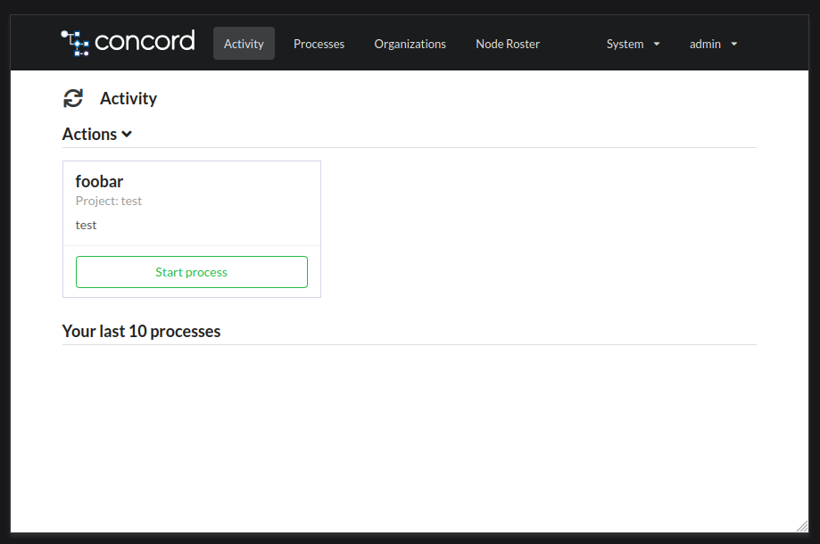
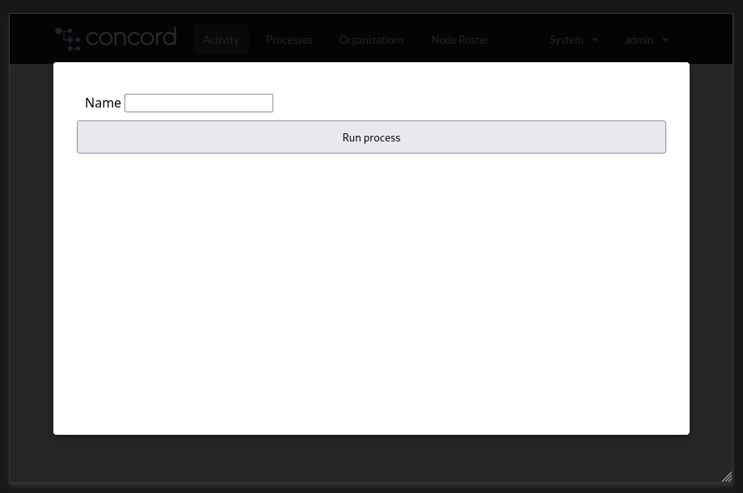

# Process Cards

Process cards are small tiles on the Activity page in the Concord UI.
Use a card to start a process with no parameters or to display a form.
The form is a static HTML page. Concord displays it when a user clicks the card.
The page can contain HTML, CSS, and JavaScript code.
This example shows how to use [HTMX](https://htmx.org/) to create a custom form that starts a process.

Follow these steps:
- Create a Concord project. Register the Git repository that contains the flow you want to run.
- Upload the form with the API. Run this command from this directory:
  ```
  curl -i \
  -H 'Authorization: yourApiKey' \
  -F org=myOrg \
  -F project=myProject \
  -F repo=myRepo \
  -F entryPoint=myFlow \
  -F name=foobar \
  -F description=Test \
  -F form=@index.html \
  http://localhost:8001/api/v1/processcard
  ```
- Log in to the Concord UI. Open the Activity page:
  
- Click "Start process" to display the form:
  

The uploaded [index.html](index.html) file contains a simple form with one input field.
When a user submits the form, the `hx-post` attribute sends a POST request to the
`/api/v1/process` endpoint. The request contains the form data.
