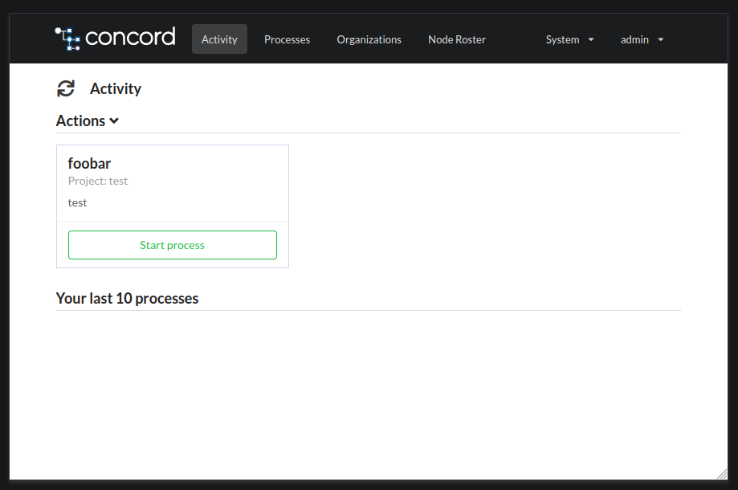
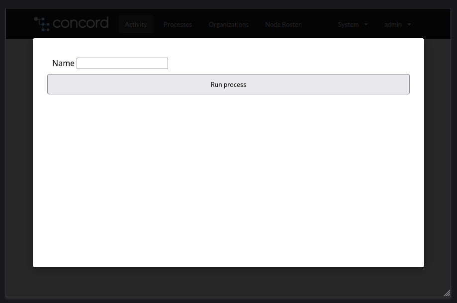

# Process Cards

"Process Cards" are little tiles on the Activity page of the Concord UI.
They can be used to start a predefined process with no parameters or to show a "form".
The form is a static HTML page that will be displayed when the user clicks on the card.
The page can contain self-contained HTML, inline CSS, and JavaScript, running in
an opaque sandbox without access to Concord credentials, storage or console DOM.

This directory retains its historical name, but the example now uses native
browser APIs and the restricted Concord bridge instead of HTMX/direct API calls.
External CDN assets and `data.js` script loads are not permitted in the sandbox.
Bundle any needed libraries inline into the uploaded HTML.

Steps:
- create a new Concord project and register the Git repository with the flow
  you want to run;
- upload the form by calling the API (while in this directory):
  ```
  curl -i \
  -H 'Authorization: yourApiKey' \
  -F org=myOrg \
  -F project=myProject \
  -F repo=myRepo \
  -F entryPoint=myFlow \
  -F name=foobar \
  -F description=Test \
  -F form=@index.html \
  http://localhost:8001/api/v1/processcard
  ```
- log into the Concord UI and check the Activity page:
  
- click on "Start process" and you should see the form:
  

The uploaded [index.html](index.html) contains a single input field. Share the
console URL `/#/processCard/{cardId}/form`, not the raw API HTML URL. Direct API
navigation returns inert `text/plain` HTML source with scripts disabled. The
console requires a browser sending `Sec-Fetch-Dest: iframe` and
`Sec-Fetch-Site: same-origin` to receive executable sandboxed HTML.

## Bridge protocol (v1)

The trusted host sends an initialization message to the sandbox:

```javascript
{
  protocol: 'concord-process-card-v1',
  type: 'init',
  channel: '<random per-document nonce>',
  data: { /* uploaded card data plus org, project, repo and entryPoint */ }
}
```

The form must check `event.source === window.parent`, reject top-level execution
(`window.parent === window`), and retain the channel from the first initialization.
Its immediate parent is a trusted relay with a card-specific frame navigation
policy; uploaded HTML never executes in that relay.
After collecting and validating input, send exactly:

```javascript
window.parent.postMessage({
  protocol: 'concord-process-card-v1',
  type: 'start',
  channel,
  arguments: { name: 'Alice' }
}, '*');
```

`'*'` is needed for an opaque sandbox; it is not an authorization check. The host
checks the exact sending frame and channel, rejects unknown message fields/types,
and allows only JSON arguments (65,536 serialized characters, nesting depth 16).
The host responds with `type: 'started', instanceId` and navigates to the generated
process log URL, or `type: 'error', message` with a sanitized error. Responses also
contain `protocol` and `channel`. Navigation messages, arbitrary URLs, HTTP
methods/headers, file uploads, and process-request options are not supported.
Duplicate concurrent starts are ignored; unmounting or navigating the frame
invalidates the channel.

Use a `type="button"` click handler and `form.reportValidity()` as in the
examples. Native form submission is disabled by the sandbox, including its
normal submit-event/validation behavior; a submit button is not a bridge trigger.

The server selects the card's stored project, repository and entry point, rechecks
read authorization and applies ordinary process execution permissions. A share
does not grant project access. Creating cards requires project writer access;
updates and sharing also require card ownership (or administrator privileges).
Users may only be shared cards for projects they can read, and teams must be in
the project's organization with an explicit project permission.

Initial card data is intentionally visible to the form. Never include API keys,
tokens, cookies or other secrets in it. Network APIs, external assets, native form
submission, popups and parent navigation are unavailable. Existing forms using
direct `/api/v1/process` calls, CDN scripts, `data.js`, or
`window.parent.location` must migrate to this protocol.
